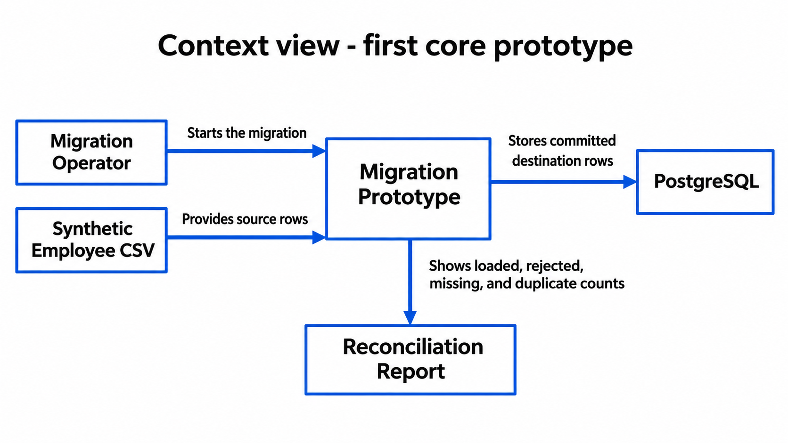
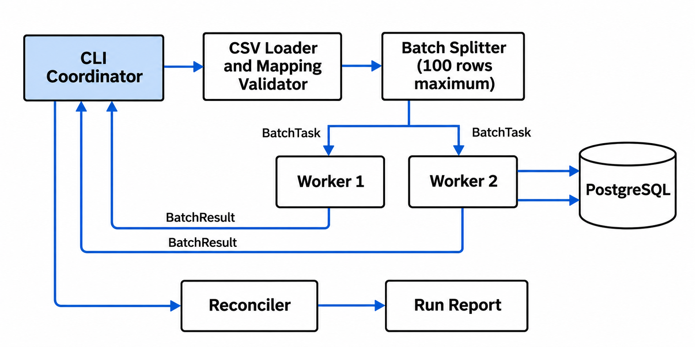

# Distributed Data Migration System Design

**Author:** Ibsan Hossain  
**Course:** CSC 59866  
**Selected project and option:** B2 - Reliable Data Exchange for Integrated Justice Records; generalized as a data-migration system  
**Current assignment:** 3  
**Sunday commit deadline:** November 22, 2026  
**Monday presentation:** November 23, 2026 
**Last updated:** November 22, 2026  
**Document status:** Revised - ready for review

# Progress note

For Assignment 3, I narrowed the first working path based on feedback from Assignments 1 and 2. Instead of beginning with the full web product and change detection, the first path will use a synthetic CSV, one fixed employee mapping, 100-row batches, two worker processes, and a reconciliation check for missing or duplicate records. I also defined the batch as the failure unit and revised the performance target to compare one worker with exactly two workers on the same computer. I selected the custom multi-worker approach over the single-worker baseline and Spark and defined the main components and batch-processing interface. A small failure experiment supported the batch rollback rule, although PostgreSQL still needs to be tested directly. My next step is to refine the data structures, algorithms, and failure cases in Assignment 4.

# Contents

- [1 Problem research and scope](#1-problem-research-and-scope)
- [2 Requirements and system specification](#2-requirements-and-system-specification)
- [3 Alternatives and selected solution](#3-alternatives-and-selected-solution)
- [4 Architectural design](#4-architectural-design)
- [5 Component design and interfaces](#5-component-design-and-interfaces)
- [6 Data structure design](#6-data-structure-design)
- [7 Algorithm design and execution](#7-algorithm-design-and-execution)
- [8 Failures and security](#8-failures-and-security)
- [9 Implementation and feasibility](#9-implementation-and-feasibility)
- [10 Testing and verification](#10-testing-and-verification)
- [11 Operation maintenance and future work](#11-operation-maintenance-and-future-work)
- [12 Revision history and references](#12-revision-history-and-references)

# 1 Problem research and scope

## Problem and affected people

The problem I am investigating is how to move structured data from an older system into a replacement system quickly and correctly when the two systems organize their data differently. Dividing a large migration among multiple workers may improve processing speed, but it also introduces a correctness problem: the system must make sure records are not skipped, duplicated, or partially committed when work is divided or retried.

The people most directly affected are employees responsible for migration work, database administrators, developers, and data engineers. Organizations are also affected because migrated records may support daily operations, reporting, auditing, and other business functions.

The Los Angeles County Sheriff's Department Integrated Justice Information System opportunity provides a real example. The County's migration requirements include data mappings, transformation logic, an initial full upload, incremental catch-up migrations, validation, reconciliation, and an audit trail. These requirements show why migration involves more than copying data and why checking the completeness of migrated records matters.

[Los Angeles County Sheriff's Department - Integrated Justice Information System, Exhibit A: Statement of Work](https://lasd.org/wp-content/uploads/2026/10/Solicitations_RFP712-SH_4_ExhA_100126.pdf)

| Stakeholder | Current task | Main need |
|---|---|---|
| Migration employee or operator | Move structured records from an old system to a replacement system | A clear and controlled migration process |
| Database administrator | Check and protect destination data | Correct and complete migrated records |
| Developer or data engineer | Define mappings, transformations, and migration logic | A process that is understandable and repeatable |
| Organization replacing a system | Move to the new system without losing important information | Accurate data and less repeated migration work |

## Current workflow

A representative migration begins by exporting structured data from the old system. A migration employee or developer inspects the source fields and determines how they correspond to the fields expected by the new system. Required transformations are defined, the data is processed and loaded into the destination, and the migrated records are checked.

The particular step this project focuses on is the processing and loading step. Instead of sending every record through one worker, the migration is divided into batches that can be handled by multiple workers.

This creates the main design question for the project: how can migration work be divided among workers without creating missing records, duplicate records, or partially completed batches?

## Concrete scenario

**Illustrative scenario, not an observed incident:** Suppose the first working path contains 1,000 synthetic employee records.

The source CSV contains:

```text
employee_number,full_name,hire_date
E101,Ava Chen,2021-05-10
E102,Marcus Lee,2020-09-01
```

The destination expects:

```text
employee_id,first_name,last_name,start_date
E101,Ava,Chen,2021-05-10
E102,Marcus,Lee,2020-09-01
```

The fixed mapping for the first working path is:

- `employee_number` -> `employee_id`
- `full_name` -> `first_name` and `last_name`
- `hire_date` -> `start_date`

The 1,000 records are divided into batches of 100 rows. Two workers can process different batches at the same time.

Each source ID must eventually be accounted for as either:

1. loaded exactly once with the approved mapped values, or
2. rejected with a documented reason.

For the first version, a name must fit the supplied splitting rule. If a name cannot be split into one first name and one last name, the row is rejected for review instead of the system guessing the missing value.

## Evidence

The LA County statement of work requires full migration, later catch-up migration, mappings, transformation rules, validation, reconciliation, and audit information. This supports the need to account for records during migration rather than only reporting that a file was processed.

Apache Spark provides an existing example of dividing larger processing work into tasks that can be executed by multiple workers. My project is not attempting to recreate Spark. Spark helps show that work division is an established approach, while my project focuses on the smaller migration-specific problem of dividing batches while checking that records are not lost or duplicated.

[Apache Spark - Cluster Mode Overview](https://spark.apache.org/docs/latest/cluster-overview.html)

## Assumptions

- The first working input is a synthetic CSV with a header row.
- Each source row has a unique `employee_number` used as the source ID.
- The destination schema is fixed and known before migration begins.
- The initial name rule expects one first name and one last name.
- Rows that do not satisfy the transformation rule are rejected instead of guessed.
- Worker processes initially run on one physical computer.
- PostgreSQL is the planned destination store.
- Synthetic data is sufficient for the initial experiments.

## Six-week contribution

The bounded contribution is one small end-to-end migration path.

The first path will:

1. read a 1,000-row synthetic employee CSV,
2. apply one fixed mapping,
3. divide the input into 100-row batches,
4. process the batches using two worker processes,
5. load accepted rows into a destination store, and
6. produce a reconciliation result that identifies loaded, rejected, missing, or duplicate source IDs.

The main question is whether this small worker-based migration can divide work while keeping the final records correct and recoverable after a batch failure.

## Semester II scope

Semester II can expand the working path after the core migration behavior is established.

Possible later additions include:

- a web interface for file upload and interactive field mapping,
- additional structured input formats,
- configurable transformation rules,
- richer monitoring,
- larger or multi-machine worker configurations, and
- changed-file or incremental catch-up processing.

These features are not part of the first working path.

## Exclusions

The current working path does not include:

- real LA County records,
- the complete LA County justice system,
- a web interface,
- interactive schema mapping,
- JSON or other additional file formats,
- incremental changed-file detection,
- a complete Change Data Capture platform,
- production cloud deployment,
- enterprise authentication,
- multi-datacenter operation, or
- claims of production-scale fault tolerance.


*Current data-migration workflow.*

# 2 Requirements and system specification

**F** means functional requirement, **C** means correctness requirement, and **Q** means quality requirement.

The requirements have been revised to separate the first working path from later Semester II features.

| ID | Required behavior and conditions | Acceptance check | Design and test reference |
|---|---|---|---|
| F1 | The first path accepts a valid CSV containing the required source fields and rejects an unsupported or malformed input before migration begins. | Provide one valid CSV and one input missing a required header. Confirm that only the valid file proceeds. | Sections 4-5; test details in Assignment 4 |
| F2 | The first path applies the fixed employee mapping from `employee_number`, `full_name`, and `hire_date` to the destination schema. Interactive mapping is deferred. | Process known source rows and compare their destination fields with expected values. | Sections 4-5 |
| F3 | The system divides valid input into batches of at most 100 rows and processes the batches using one or two workers. | Run a 1,000-row input and confirm that ten batch tasks are created and all are accounted for. | Sections 4-5 |
| F4 | After a run, the system produces counts for loaded rows, rejected rows, missing source IDs, and duplicate source IDs. | Compare a known set of source IDs with the destination and rejection results. | Sections 4-5 |
| F5 | Changed-file detection is a later Semester II requirement and is not part of the first working path. | No Assignment 3 acceptance check. | Deferred |
| C1 | Every source ID must be accounted for as either loaded exactly once with the approved mapped values or rejected with a documented reason. | Compare the source ID set with loaded and rejected IDs. The difference must be empty and no loaded ID may occur more than once. | Sections 4-5 |
| C2 | One migration failure unit is one batch of at most 100 rows. If a worker or database failure occurs before commit, zero destination rows from that batch are committed. A successful retry must not create duplicate IDs. | Simulate a failure after writing row 37 of a 100-row batch but before commit. Confirm that 0 rows remain after rollback. Retry the complete batch and confirm all 100 expected IDs appear once. | Section 9 |
| Q1 | **Proposed target:** On the same computer, the same 100,000-row synthetic CSV and transformations will be run five times with one worker and five times with exactly two workers. After resetting the destination between runs, the median two-worker throughput should be at least 25% higher in records per second while still satisfying C1 and C2. | Record elapsed time and throughput for every run. Compare the median one-worker and two-worker results and perform reconciliation after each run. | Planned; not yet measured |

## Inputs and outputs

Example input:

```text
employee_number,full_name,hire_date
E101,Ava Chen,2021-05-10
E102,Marcus Lee,2020-09-01
```

Expected output:

```text
employee_id,first_name,last_name,start_date
E101,Ava,Chen,2021-05-10
E102,Marcus,Lee,2020-09-01
```

Example unsuccessful transformation:

```text
employee_number,full_name,hire_date
E103,Cher,2022-04-18
```

Under the first name-splitting rule, `Cher` does not provide the expected first-name and last-name pair.

The system should not guess a last name. `E103` should be rejected with a reason such as `name_split_rule` and included in the reconciliation result.

## Constraints

- The first implementation runs on one available computer.
- The comparison is exactly one worker versus two workers.
- One batch contains at most 100 rows.
- The first input format is CSV.
- PostgreSQL is the planned destination database.
- Only synthetic data is used.
- Web features and incremental change tracking are deferred.

# 3 Alternatives and selected solution

The three approaches from Assignment 2 were reconsidered using the smaller working path and the same correctness requirements.

| Approach | Useful behavior | Main limitation |
|---|---|---|
| Single-worker baseline | Can read, transform, load, and reconcile the CSV without worker coordination. It provides the baseline for Q1. | Does not investigate the main work-division question. |
| Custom two-worker pipeline | Applies the same mapping while dividing 100-row batches between two workers. The project directly controls batch size, failure behavior, retry behavior, and reconciliation. | Requires explicit worker coordination and failure handling. |
| Apache Spark | Can divide structured processing work among workers and process data in parallel. | Adds a large general-purpose framework while migration-specific mapping, rejection, reconciliation, and destination behavior still need to be built. |

All three approaches still require application logic for mapping, rejected rows, reconciliation, and any later changed-file feature.

## Selected solution

The selected solution is the **custom two-worker migration pipeline**.

The single-worker version remains the baseline for comparison. Apache Spark remains an existing distributed alternative but is not selected for the first implementation.

The custom design is selected because the main project question is how migration work should be divided, recovered, and checked. Building the worker pipeline directly makes those decisions visible and testable.

## Decision 1 - Custom two-worker pipeline instead of Spark

**Context and requirement:**  
F3 and Q1 require a worker-based migration path and a comparison between sequential and parallel processing. C1 and C2 require the correctness of divided work to remain visible.

**Options:**

1. one sequential worker,
2. a custom two-worker process pool, or
3. Apache Spark.

**Decision and reason:**  
Use a custom two-worker Python pipeline for the first path. Keep one-worker mode as the baseline.

This allows the project to directly investigate worker assignment, batch results, retries, and reconciliation instead of relying on a larger framework to manage most of that behavior.

**Consequences:**  
The design must implement its own batch coordination and failure handling. It does not receive Spark's built-in scheduling features. However, the smaller design should be easier to understand and test on one computer.

**Status and revisit condition:**  
Accepted for the first working path. Reconsider Spark or another framework if later work requires multi-machine execution or if the custom design becomes too difficult to scale.

## Decision 2 - 100-row batches as the failure unit

**Context and requirement:**  
C2 previously referred to a general "unit of migration work." The design needs one exact unit so that a failure has one expected destination state.

**Options:**

1. commit every row separately,
2. use a 100-row batch as the transaction unit, or
3. use the entire input file as one transaction.

**Decision and reason:**  
Use a batch of at most 100 rows as the failure and transaction unit.

The worker processes the batch and writes accepted destination rows within one transaction. If the batch fails before commit, none of those writes should remain committed.

**Consequences:**  
A failed batch may require reprocessing up to 100 rows, but the recovery rule is simple: the batch either committed or it did not.

A normal row rejection is different from a batch failure. A rejected row is recorded with a reason, while other valid rows in a successfully completed batch can still be committed.

**Status and revisit condition:**  
Accepted for the first path. Reconsider the batch size if later performance results show too much transaction overhead or another size performs better.

# 4 Architectural design

## Context view



## Architecture view



## Responsibilities and communication

**CLI Coordinator:**  
Starts the migration, selects one-worker or two-worker mode, sends batches to workers, receives results, and starts reconciliation.

**CSV Loader and Mapping Validator:**  
Reads the CSV, checks required headers, and applies the fixed mapping.

**Batch Splitter:**  
Divides the input into batches containing no more than 100 rows.

**Worker 1 and Worker 2:**  
Receive batch tasks, transform records, identify rejected rows, and attempt destination writes.

**PostgreSQL:**  
Stores committed destination employee rows and acts as the authoritative destination store.

**Reconciler:**  
Compares source IDs, rejected IDs, and stored destination IDs. It reports missing IDs, duplicate IDs, and mapped-value mismatches.

## Saved state

The important persistent state includes:

- committed destination employee records,
- their source IDs, and
- enough run or batch information to determine which work completed.

The detailed data structures will be defined in Assignment 4.

## Where parts run

For the first implementation:

- the CLI coordinator runs on one computer,
- worker 1 and worker 2 run as separate processes on that computer,
- PostgreSQL runs locally, and
- reconciliation runs after processing.

This setup demonstrates separate worker processes and overlapping work. It does not claim to represent a production multi-machine system.

## What I build, reuse, or simulate

**Build:**

- CSV validation,
- fixed mapping,
- batch creation,
- coordinator logic,
- worker transformation,
- reconciliation, and
- run reporting.

**Reuse:**

- Python process support,
- PostgreSQL storage and transactions.

**Simulate:**

- a controlled failure during the feasibility experiment.

# 5 Component design and interfaces

## Component responsibility table

| Component | Responsibility | Input | Output or state change |
|---|---|---|---|
| CSV Loader | Read CSV and verify required fields | CSV file | Parsed rows or error |
| Mapping Validator | Check/apply fixed employee mapping | Source headers and mapping | Approved mapping or error |
| Batch Splitter | Divide work into fixed units | Valid source rows | Batches of up to 100 rows |
| Coordinator | Assign batches and collect worker results | Batch tasks | Batch statuses and run totals |
| Worker | Transform a batch, reject invalid rows, and write valid rows | Batch task | Batch result and destination changes |
| PostgreSQL Store | Persist accepted employee records | Transformed rows | Committed rows or transaction failure |
| Reconciler | Compare expected and observed IDs | Source, rejected, and destination IDs | Loaded, rejected, missing, duplicate, and mismatch counts |

## Critical operation - PROCESS_BATCH

The critical operation is `PROCESS_BATCH`. It is linked to F3, C1, and C2.

### Input

A batch task contains:

```text
batch_id
up to 100 source rows
approved mapping identifier
```

Example:

```text
employee_number = E101
full_name = Ava Chen
hire_date = 2021-05-10
```

### Output

Expected transformed values:

```text
employee_id = E101
first_name = Ava
last_name = Chen
start_date = 2021-05-10
```

A successful batch result contains:

```text
batch_id
status = completed
loaded_ids
rejected_rows_with_reasons
elapsed_time
```

Example:

```text
batch_id = B03
status = completed
loaded_count = 99
rejected_count = 1
rejected = [(E245, name_split_rule)]
```

The batch is still considered completed because the rejected row was handled according to the defined transformation rule.

### State changes

For accepted rows:

1. transform the source values,
2. begin the batch transaction,
3. write accepted rows,
4. commit the transaction, and
5. report the batch as completed.

Rejected rows do not create destination employee records.

### Errors

**Missing required source field:**  
Stop the migration before batch processing begins.

**Name does not fit the split rule:**  
Reject the row with `name_split_rule`.

**Worker or database failure before commit:**  
Roll back the batch transaction. Zero rows from that transaction remain committed.

**Duplicate or conflicting source ID:**  
Do not silently create another destination record. Report the conflict for reconciliation.

### Unsuccessful example

Suppose batch B04 contains 100 rows.

A simulated failure occurs after the 37th row has been written inside the open transaction but before commit.

Expected state after rollback:

```text
batch B04 status = failed
committed destination rows from B04 = 0
```

After retrying the complete batch successfully:

```text
stored IDs = 100
missing IDs = 0
duplicate IDs = 0
incorrect mapped values = 0
```

### Repeated or overlapping calls

The two workers may process different batches at the same time.

During a normal run, the same batch should not intentionally be assigned to two workers.

If a failed batch is retried, destination uniqueness rules and reconciliation are used to make sure that the retry does not create duplicate employee IDs.

The exact retry limit and timeout behavior will be defined in Assignment 4.

# 6 Data structure design

**Work to come - Assignment 4.**

# 7 Algorithm design and execution

**Work to come - Assignment 4.**

# 8 Failures and security

**Work to come - Assignment 4.**

# 9 Implementation and feasibility

## Minimal implementation path

The smallest useful path is:

1. read a 1,000-row synthetic employee CSV,
2. validate the required fields,
3. apply the fixed employee mapping,
4. split the file into ten 100-row batches,
5. process the batches using two worker processes,
6. store accepted transformed records,
7. record rejected rows with reasons, and
8. reconcile the source IDs against the destination and rejection results.

The first path does not require a web interface, interactive field mapping, additional file formats, or changed-file detection.

## Feasibility experiment

### Question

Can a 100-row batch fail before commit and then be retried without leaving partial data, missing IDs, or duplicate IDs?

### Procedure

A small Python experiment created 100 synthetic employee records with IDs E0001 through E0100.

The test:

1. began one transaction for the 100-row batch,
2. transformed and inserted records,
3. raised a simulated failure after the 37th row was written but before the transaction committed,
4. rolled back the transaction,
5. checked the number of rows remaining,
6. retried the full 100-row batch,
7. committed the retry, and
8. checked the IDs and mapped values.

SQLite was used as a lightweight stand-in for the experiment. PostgreSQL remains the planned final destination and will need the same failure test later.

### Actual evidence

```text
Failure: simulated failure after writing row 37 before commit
Rows stored after rollback: 0
Rows stored after retry: 100
Missing IDs after retry: 0
Duplicate IDs after retry: 0
Rows with incorrect mapped values: 0
```

### Finding

The experiment supports using the batch as the transaction and failure unit.

Even though 37 rows had been written inside the transaction, the rollback left zero committed destination rows from the failed batch.

After retrying the complete batch, all 100 expected IDs were present exactly once and their mapped values were correct.

### Resulting design decision

Keep a 100-row batch as the initial transaction and failure unit.

If a batch fails before commit, roll back the entire batch and retry the full batch rather than trying to resume at an uncertain row.

### Limitation

This experiment used SQLite rather than PostgreSQL.

It supports the batch design, but it does not prove PostgreSQL behavior for the final implementation. The same controlled failure needs to be tested with PostgreSQL later.

## Current implementation status

**Implemented in the feasibility experiment:**

- 100 synthetic keyed employee rows,
- fixed field transformation,
- transaction containing batch writes,
- controlled failure after row 37,
- rollback,
- full batch retry,
- missing-ID check,
- duplicate-ID check,
- mapped-value check.

**Planned next:**

- PostgreSQL,
- 1,000-row input,
- 100-row batch splitter,
- one-worker mode,
- two-worker mode,
- reconciliation report.

**Deferred:**

- web interface,
- interactive field mapping,
- changed-file detection,
- additional file formats.

## Run instructions and CI

The feasibility experiment will be kept in the repository with its output evidence.

The full PostgreSQL migration instructions will be added to `README.md` as that path is implemented.

Automated CI for the complete migration path is not yet configured.

# 10 Testing and verification

**Work to come - Assignment 4.**

# 11 Operation maintenance and future work

**Work to come - later assignments.**

# 12 Revision history and references

## Revision history

| Revision date | Change to my design | Reason and evidence |
|---|---|---|
| November 6, 2026 | Created the initial Assignment 1 problem and scope. | Assignment 1 required the problem, people, workflow, evidence, and project boundary. |
| November 13, 2026 | Added requirements, correctness rules, quality target, and alternatives. | Assignment 2 required observable behavior and possible approaches. |
| November 22, 2026 | Narrowed the first path, defined 100-row batches and exactly two workers, deferred web/change detection, selected the custom worker architecture, defined components and interfaces, and tested the batch failure rule. | Feedback from Assignments 1 and 2 identified excessive scope, an unclear failure unit, an unfixed worker count, and missing feasibility evidence. |

## Feedback incorporated

| Prior feedback | Assignment 3 revision |
|---|---|
| First working path was too broad. | Limited the path to CSV, fixed mapping, two workers, storage, and reconciliation. |
| Distributed need was not tied to a specific migration step. | Focused the project on dividing the processing/loading stage into worker batches. |
| C2 did not define a failure unit. | Defined one batch as at most 100 rows and made it the transaction/failure unit. |
| Q1 did not fix the worker count or test method. | Fixed the comparison at one worker versus two workers, five runs each, on the same machine. |
| F5 made the first path larger than necessary. | Deferred changed-file detection until the first path works. |
| Workflow image and navigation were missing. | Restored the workflow image and changed the contents to normal Markdown links. |
| Separate weekly files broke continuity. | Assignment 3 will update the single repository file named `DESIGN.md`. |

## Open question

| Open question | Why it matters | Next action |
|---|---|---|
| Does using two workers improve throughput enough to justify the extra coordination while still keeping reconciliation and batch recovery correct? | The answer determines whether the distributed design provides a useful benefit over the one-worker baseline. | Implement the one-worker and two-worker paths and run the fixed Q1 performance comparison. |

## Assistance and reuse

This document is based on my B2 Problem Understanding Paper, the course provided design template, and the Software Project Design Handbook. No PostgreSQL performance results are claimed in this Assignment 3 draft.

## References

1. Los Angeles County Sheriff's Department. *Integrated Justice Information System - Exhibit A: Statement of Work, RFP 712-SH.* Supports the migration problem, mappings, transformation, validation, reconciliation, and full/incremental migration requirements.

   https://lasd.org/wp-content/uploads/2026/10/Solicitations_RFP712-SH_4_ExhA_100126.pdf

2. Apache Spark. *Cluster Mode Overview.* Supports the existing distributed-processing approach of dividing larger jobs into tasks and coordinating worker processes.

   https://spark.apache.org/docs/latest/cluster-overview.html

3. Apache Spark. *Spark SQL, DataFrames and Datasets Guide.* Supports Spark as an existing structured-data processing alternative.

   https://spark.apache.org/docs/latest/sql-programming-guide.html

4. PostgreSQL Global Development Group. *Transactions.* Supports the design reasoning for grouping destination operations into a transaction.

   https://www.postgresql.org/docs/current/tutorial-transactions.html

5. Python Software Foundation. *concurrent.futures - Launching parallel tasks.* Supports the planned local process-based worker model.

   https://docs.python.org/3/library/concurrent.futures.html

6. CSC 59866 course materials. *Software Project Design Handbook* and *Design Document Template*, Fall 2026. Used for the Assignment 3 structure and requirements.
