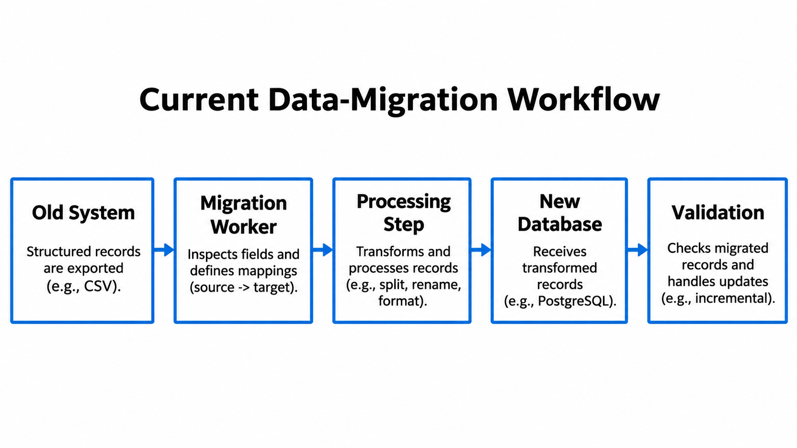

# Distributed Data Migration System Design

**Author:** Ibsan Hossain  
**Course:** CSC 59866  
**Selected project and option:** B2 - Reliable Data Exchange for Integrated Justice Records; generalized as a data-migration system  
**Current assignment:** 3  
**Sunday commit deadline:** November 22, 2026  
**Monday presentation:** November 23, 2026  
**Last updated:** November 22, 2026  
**Document status:** Revised - ready for review

# Progress note

For Assignment 3, I kept the larger Semester II goal from Assignments 1 and 2: a web-based data-migration system where a user can upload structured data, map source fields to a destination schema, start a multi-worker migration, monitor progress and errors, and later identify changed records from a newer source file. Based on the feedback from Assignments 1 and 2, I narrowed only the first working path so the core distributed behavior can be tested clearly. The first path uses a synthetic CSV, one fixed employee mapping, 100-row batches, exactly two worker processes, PostgreSQL as the planned destination, and reconciliation checks for missing or duplicate records. I selected the custom multi-worker approach over the single-worker baseline and Spark, defined the batch as the failure unit, and completed a rollback-and-retry feasibility experiment. My next step is to refine the data structures, algorithms, retry behavior, and monitoring details in Assignment 4.

# Contents

- [1 Problem research and scope](#1-problem-research-and-scope)
- [2 Requirements and system specification](#2-requirements-and-system-specification)
- [3 Alternatives and selected solution](#3-alternatives-and-selected-solution)
- [4 Architectural design](#4-architectural-design)
- [5 Component design and interfaces](#5-component-design-and-interfaces)
- [6 Data structure design](#6-data-structure-design)
- [7 Algorithm design and execution](#7-algorithm-design-and-execution)
- [8 Failures and security](#8-failures-and-security)
- [9 Implementation and feasibility](#9-implementation-and-feasibility)
- [10 Testing and verification](#10-testing-and-verification)
- [11 Operation maintenance and future work](#11-operation-maintenance-and-future-work)
- [12 Revision history and references](#12-revision-history-and-references)

# 1 Problem research and scope

## Problem and affected people

The problem I am investigating is how to move a large amount of structured data from an older system into a replacement system quickly and correctly when the two systems may organize their data differently and the original data may continue changing during the migration. Dividing the processing work among multiple workers may improve speed, but it also introduces correctness problems because the system must make sure records are not skipped, duplicated, incorrectly transformed, or partially committed when work is divided or retried.

The people most directly affected are employees responsible for migration work, database administrators, developers, and data engineers. Organizations are also affected because migrated records may support daily operations, reporting, auditing, and other business functions.

The Los Angeles County Sheriff's Department Integrated Justice Information System opportunity provides a real example. The County's migration requirements include data mappings, transformation logic, an initial full upload, incremental catch-up migrations, validation, reconciliation, and an audit trail. These requirements show why migration involves more than copying data once.

[Los Angeles County Sheriff's Department - Integrated Justice Information System, Exhibit A: Statement of Work](https://lasd.org/wp-content/uploads/2026/10/Solicitations_RFP712-SH_4_ExhA_100126.pdf)

| Stakeholder | Current task | Main need |
|---|---|---|
| Migration employee or operator | Move structured records from an old system to a replacement system | A clear migration process, visible progress, and useful error reporting |
| Database administrator | Check and protect destination data | Correct and complete migrated records |
| Developer or data engineer | Define mappings, transformations, and migration logic | A process that is understandable, repeatable, and testable |
| Organization replacing a system | Move to the new system without losing important information | Accurate data and less repeated migration work |

## Current workflow

A representative migration begins by exporting structured data from the old system. A migration employee or developer inspects the source fields and determines how they correspond to the fields expected by the new system. Required transformations are defined, the data is processed and loaded into the destination, and the migrated records are checked. If records are incorrect or the original data changes before final cutover, part of the migration may need to be repeated.

The difficulty occurs when the old and new schemas do not match directly, when the amount of data is large enough that processing becomes slow, when a worker or database operation fails, or when source records change after part of the migration has already been completed.

The distributed part of this project focuses on the processing and loading stage. Instead of sending every record through one worker, the migration can be divided into smaller batches that are assigned to multiple workers. This creates the main correctness question: how can work be divided without creating missing records, duplicate records, incorrect destination values, or partially completed batches?

## Concrete scenario

**Illustrative scenario, not an observed incident:** Suppose an organization needs to migrate five million employee records. The old file contains `employee_number`, `full_name`, and `hire_date`, while the new system expects `employee_id`, `first_name`, `last_name`, and `start_date`.

The user needs to map the old fields to the new schema. After the mapping is confirmed, the migration system processes the data and loads it into the destination. With a large dataset, a single processing path may be slow, so the work can be divided among multiple workers. The system should also show progress and report records or batches that fail.

The larger product must also handle a later version of the source data. If a newer file contains records that changed after the initial migration, the system should be able to identify the new or changed records instead of processing every unchanged record again.

For the first working prototype, this scenario is intentionally reduced to 1,000 synthetic employee rows so the core behavior can be tested before the web interface and change-tracking layer are added.

Example source data:

```text
employee_number,full_name,hire_date
E101,Ava Chen,2021-05-10
E102,Marcus Lee,2020-09-01
```

Example destination data:

```text
employee_id,first_name,last_name,start_date
E101,Ava,Chen,2021-05-10
E102,Marcus,Lee,2020-09-01
```

The first prototype uses this fixed mapping:

- `employee_number` -> `employee_id`
- `full_name` -> `first_name` and `last_name`
- `hire_date` -> `start_date`

The 1,000 records are divided into batches of 100 rows. Two workers can process different batches at the same time.

Each source ID must eventually be accounted for as either:

1. loaded exactly once with the approved mapped values, or
2. rejected with a documented reason.

For the first version, a name must fit the supplied splitting rule. If a name cannot be split into one first name and one last name, the row is rejected for review instead of the system guessing a missing value.

## Evidence

The LA County statement of work requires an initial full data upload, later catch-up migrations, mappings, transformation rules, validation, reconciliation, and audit information. This supports the need to account for records during migration and deal with later source changes rather than only reporting that one file was processed.

Apache Spark provides an existing example of dividing larger processing work into tasks that can be executed by multiple workers. My project is not attempting to recreate Spark. Spark helps show that work division is an established approach, while my project focuses on a smaller migration-specific system that combines mapping, distributed processing, destination correctness, monitoring, and later file-based change tracking.

[Apache Spark - Cluster Mode Overview](https://spark.apache.org/docs/latest/cluster-overview.html)

## Assumptions

- CSV will be the first supported structured input format.
- Each source record has a usable key, such as `employee_number`, so records can be identified across processing and later file versions.
- The destination schema and required fields are known before mapping begins.
- The first version supports a limited set of transformations such as renaming fields, splitting a value, and formatting dates.
- Synthetic data is sufficient for design and testing, so real LA County records are not required.
- Multiple worker processes may run on one physical computer during development.
- PostgreSQL is the planned destination database.
- A web interface will be part of the completed Semester II product, even though the first core prototype can temporarily use fixed input and mapping to test distributed behavior.
- The exact web framework and the detailed change-tracking data structures can be finalized later.

## Six-week contribution

During this six-week design period, I will define the bounded core migration capability that the Semester II system will implement. The focus is the path from structured source data to a mapped destination schema, followed by dividing the migration into smaller units of work that can be assigned to multiple workers and loaded into a destination database.

The design also keeps the larger product requirements visible: a web interface for upload and mapping, progress and error monitoring, and limited file-based change detection.

The bounded first working path is smaller: 1,000 synthetic CSV rows, one fixed mapping, 100-row batches, exactly two workers, destination loading, and reconciliation. This smaller path is intended to prove the core processing and correctness behavior before the surrounding web and change-tracking features are connected.

## Semester II scope

The larger Semester II goal is to implement a working general-purpose **web-based data-migration product**.

A user will be able to:

1. upload structured source data through a web interface,
2. view the source fields,
3. map source fields to the required destination schema,
4. start the migration,
5. have the migration divided into smaller jobs and processed by multiple workers,
6. load accepted transformed records into PostgreSQL,
7. monitor migration progress and see failed records, failed batches, worker errors, or database errors,
8. review a final migration and reconciliation report, and
9. provide a newer version of the source file so the system can identify new or changed records without repeating all unchanged work.

CSV will be the initial structured input format. The design should keep input parsing separate enough that another structured format, such as JSON, can be added later without redesigning the entire pipeline.

The monitoring feature is part of the final product. It is intended to report migration progress, worker or database failures, rejected records, failed batches, and the final result to the user.

The change-tracking feature will be limited to file-based input. It is not intended to recreate a complete database Change Data Capture platform.

## Exclusions

The overall project does not include:

- real LA County records or development of the complete LA County justice system,
- support for every possible database, file type, or transformation language,
- enterprise authentication,
- production cloud deployment,
- multi-datacenter operation,
- claims that a classroom prototype provides production-scale fault tolerance, or
- a complete transaction-log Change Data Capture platform such as Debezium.

The web interface, monitoring, and limited file-based change tracking are **not exclusions**. They remain part of the larger Semester II product, although they do not all need to be implemented in the first core prototype.



*Figure 1. Current data-migration workflow.*

# 2 Requirements and system specification

The requirements below describe the **completed Semester II system**. The first working prototype implements only the smaller subset needed to prove the core distributed-processing and correctness path.

**F** means functional requirement, **C** means correctness requirement, and **Q** means quality requirement.

| ID | Required behavior and conditions | Acceptance check | Design and test reference |
|---|---|---|---|
| F1 | The completed system must accept a valid CSV file through the web interface, identify its source fields, and reject an unsupported or malformed input before migration begins. | Upload a valid CSV and confirm that its field names are shown. Then provide an invalid input and confirm that migration does not begin. | Sections 4-5 |
| F2 | Before migration begins, the user must be able to map the required source fields to the fields expected by the destination schema. | Using the employee example, map `employee_number`, `full_name`, and `hire_date` to the required destination fields and confirm that the approved mapping is saved for the run. | Sections 4-5 |
| F3 | After the mapping is confirmed, the system must divide the migration into batches and process the source records through one or more workers while producing records that follow the destination schema. It must identify records or batches that fail. | Run a known synthetic dataset, confirm the expected batches are created, and compare successful and failed results with the expected output. | Sections 4-5 |
| F4 | The user must be able to monitor migration status and errors and view a final summary containing total, completed, rejected/failed, missing, and duplicate results. | Run a controlled migration and confirm that progress/error information changes during processing and that the final totals match the actual results. | Sections 4-5 |
| F5 | When a newer version of previously migrated source data is provided, the completed system should identify new or changed records so unchanged records do not need to be processed again. | Use an original file and a second version containing an unchanged record, a changed record, and a new record. Confirm that the changed and new records are identified for later processing. | Later Semester II |
| C1 | Every record reported as successfully migrated must match the approved field mapping and transformation rules and must be accounted for exactly once. | Compare the source IDs, rejected IDs, and destination records with known expected results. | Sections 4-5 |
| C2 | One initial migration failure unit is one batch of at most 100 rows. If a worker or database failure occurs before commit, zero destination rows from that batch are committed. A successful retry must not create duplicate IDs. | Simulate a failure after writing row 37 of a 100-row batch but before commit. Confirm that 0 rows remain after rollback. Retry the complete batch and confirm all expected IDs appear once. | Section 9 |
| Q1 | **Proposed target:** On the same computer, the same 100,000-row synthetic CSV and transformations will be run five times with one worker and five times with exactly two workers. After resetting the destination between runs, the median two-worker throughput should be at least 25% higher in records per second while still satisfying C1 and C2. | Record elapsed time and throughput for every run. Compare the median one-worker and two-worker results and perform reconciliation after each run. | Planned; not yet measured |

## First-prototype requirement subset

The first core prototype concentrates on the part of the requirements needed to test the distributed migration path:

- CSV input with known required fields,
- one fixed employee mapping instead of interactive web mapping,
- 100-row batches,
- exactly two workers,
- PostgreSQL as the planned destination,
- row rejection,
- batch rollback/retry behavior,
- progress/error information at the coordinator level, and
- reconciliation for loaded, rejected, missing, and duplicate IDs.

The web upload/mapping interface and F5 change tracking are added after this core path works.

## Inputs and outputs

Ordinary input:

```text
employee_number,full_name,hire_date
E101,Ava Chen,2021-05-10
E102,Marcus Lee,2020-09-01
```

Expected destination data:

```text
employee_id,first_name,last_name,start_date
E101,Ava,Chen,2021-05-10
E102,Marcus,Lee,2020-09-01
```

Example mapping error in the completed web system:

If the destination requires `employee_id` but the user does not map any source field to it, the system should identify the missing required mapping and prevent the migration from starting.

Example row-level transformation error in the first prototype:

```text
employee_number,full_name,hire_date
E103,Cher,2022-04-18
```

Under the first name-splitting rule, `Cher` does not provide the expected first-name and last-name pair. The system should not guess a last name. `E103` should be rejected with a reason such as `name_split_rule` and included in the monitoring/reconciliation result.

## Constraints

- The project is completed by one student, so the system must remain small enough to design, build, and test during the course.
- CSV is the first supported input format.
- PostgreSQL is the planned destination database.
- The project must run and be testable on the available computer.
- Multiple worker processes may run on one computer during development, but this is not described as equivalent to a production multi-machine distributed system.
- Only public documentation and synthetic data are used.
- Production cloud deployment, enterprise authentication, and a complete Change Data Capture system are outside the project scope.

# 3 Alternatives and selected solution

The alternatives are compared against the same overall migration product. The distributed-processing choice does not remove the web interface, mapping, monitoring, or later file-based change-tracking requirements.

| Approach | Useful behavior | Main limitation |
|---|---|---|
| Single-worker ETL baseline | One worker can read, transform, load, and reconcile records in order. It is simpler and provides a baseline for Q1. The same web mapping and monitoring layer could still be placed around it. | All processing is sequential and may become slow for larger datasets. Change tracking and monitoring still require application logic. |
| Custom multi-worker migration system | The migration can be divided into smaller jobs processed by multiple workers. The same focused application can contain the web UI, field mapping, progress/error monitoring, reconciliation, and later file-based change tracking. | The design must explicitly handle batch assignment, failures, retries, duplicate work, coordination, and job size. |
| Apache Spark | Spark already supports parallel processing of structured data and could handle the large-data processing portion. | Spark is a general-purpose processing framework rather than the complete migration product. The web mapping interface, user-facing progress/error reporting, destination rules, reconciliation, and file-based change tracking still require separate application logic. |

## Comparison against the same requirements

| Requirement area | Single-worker baseline | Custom multi-worker system | Apache Spark |
|---|---|---|---|
| F1-F2: web input and field mapping | Can support through application logic. | Built into the same migration application. | Requires a separate application layer around Spark. |
| F3: processing | Sequential. | Divides batches among workers. | Strong parallel-processing support. |
| F4: progress/error monitoring | Must be added. | Can be designed directly into the migration system. | User-facing monitoring still requires separate application logic. |
| F5: file-based change detection | Must be added. | Can be included in the same file-based workflow. | Must be added separately for uploaded files. |
| C1-C2: correctness and failure behavior | Simpler to coordinate. | Requires explicit batch coordination and retry rules. | Migration-specific destination rules still need to be designed. |
| Q1: throughput improvement | Baseline only. | Intended to improve throughput and will be measured. | Designed for parallel processing but may add unnecessary complexity for this project. |

## Selected solution

The selected solution is the **custom multi-worker migration system inside the larger web-based migration product**.

The single-worker version remains the baseline for comparison. Apache Spark remains an existing distributed alternative but is not selected for the first implementation.

This choice preserves the original project goal: building my own migration application with web-based upload and mapping, distributed processing, monitoring/error reporting, reliable PostgreSQL loading, reconciliation, and limited file-based change detection. At the same time, it lets the first implementation focus on the worker-coordination and correctness problem rather than hiding that behavior behind a larger framework.

## Decision 1 - Custom multi-worker pipeline instead of Spark

**Context and requirement:**  
F3 and Q1 require a worker-based migration path and a comparison between sequential and parallel processing. The completed system also needs the migration-specific behavior in F1, F2, F4, and F5.

**Options:**

1. one sequential worker,
2. a custom two-worker process pool for the first distributed version, or
3. Apache Spark.

**Decision and reason:**  
Use a custom Python multi-worker pipeline, beginning with exactly two workers. Keep one-worker mode as the baseline.

This lets the project directly investigate worker assignment, batch results, retries, reconciliation, and monitoring while still fitting inside the larger web-based migration application.

**Consequences:**  
The design must implement its own batch coordination and failure handling. It does not receive Spark's full scheduling features. However, the important migration behavior remains visible and testable, and the web/mapping/monitoring layers can connect directly to the custom coordinator.

**Status and revisit condition:**  
Accepted for the first implementation. Reconsider Spark or another framework if later work requires multi-machine scale or the custom coordinator becomes too limited.

## Decision 2 - 100-row batches as the initial failure unit

**Context and requirement:**  
C2 previously referred to a general "unit of migration work." The design needs one exact unit so that a worker/database failure has one expected destination state.

**Options:**

1. commit every row separately,
2. use a 100-row batch as the transaction unit, or
3. use the entire input file as one transaction.

**Decision and reason:**  
Use a batch of at most 100 rows as the initial failure and transaction unit.

The worker processes the batch and writes accepted destination rows within one transaction. If the batch fails before commit, none of those writes should remain committed.

**Consequences:**  
A failed batch may require reprocessing up to 100 rows, but the recovery rule is simple: the batch either committed or it did not. A normal row rejection is different from a batch failure. A rejected row is recorded with a reason while other valid rows in a successfully completed batch can still be committed.

**Status and revisit condition:**  
Accepted for the first path. Reconsider the batch size after performance and resource measurements.


# 4 Architectural design

The architecture is described at two levels:

1. the **target Semester II product**, which includes the web UI, mapping, monitoring, and change tracking, and
2. the **first core prototype**, which temporarily uses a fixed mapping so the distributed processing and correctness behavior can be tested first.

## Architecture view - target Semester II product


*Figure 2. Target Semester II system architecture.*

## Context view - first core prototype


*Figure 3. First core prototype context view.*

## Responsibilities and communication

**Web Interface - target product:**  
Lets the user upload the source file, view fields, define the source-to-destination mapping, start the migration, and view progress, errors, and the final result.

**Schema Mapping and Validation - target product:**  
Checks that required destination fields have valid source mappings and stores the approved mapping for the run. The first prototype temporarily replaces this interactive step with one fixed employee mapping.

**CSV Loader:**  
Reads the CSV and identifies source rows and required fields.

**Migration Coordinator:**  
Starts the migration, selects one-worker or two-worker mode for experiments, creates or requests batches, assigns work, receives batch results, tracks run state, and sends status/error information to the monitoring layer.

**Batch Splitter:**  
Divides the input into batches containing no more than 100 rows in the first implementation.

**Worker 1 and Worker 2:**  
Receive batch tasks, perform the approved transformations, identify rejected rows, and attempt destination writes.

**PostgreSQL:**  
Stores committed destination records and acts as the authoritative destination store.

**Monitoring and Error Reporting:**  
Tracks progress and reports completed batches, rejected records, failed batches, worker errors, database errors, and final totals to the user. In the first prototype, this can begin as coordinator/run-report output before being connected to the web UI.

**Reconciler:**  
Compares source IDs, rejected IDs, and stored destination IDs. It reports missing IDs, duplicate IDs, and mapped-value mismatches.

**File Change Tracker - later Semester II:**  
When a newer source file is uploaded, compares record keys and stored version/hash information so new or changed records can be selected for processing again.

## Communication

The main communication path is:

1. the user uploads a source file through the web interface,
2. the user approves the mapping,
3. the coordinator starts the migration,
4. the batch splitter creates work units,
5. workers receive `BatchTask` messages,
6. workers return `BatchResult` information and write accepted rows to PostgreSQL,
7. monitoring receives progress/error events,
8. reconciliation compares expected and observed records, and
9. the final status is shown to the user.

For the first prototype, steps 1-2 are temporarily replaced with a known CSV and fixed mapping.

## Saved state

The important persistent state includes:

- approved mapping information for a migration run,
- committed destination records,
- source record IDs,
- run and batch status,
- rejected records and reasons,
- error information needed for the final report, and
- later, record hash/version information used for file-based change tracking.

Detailed schemas and retention rules will be defined in Assignment 4.

## Where parts run

For development and the first implementation:

- the web application can run locally,
- the coordinator runs on one computer,
- worker 1 and worker 2 run as separate processes on that computer,
- PostgreSQL runs locally,
- monitoring/reconciliation run locally, and
- the later change-tracking logic can run in the same application.

This setup demonstrates separate worker processes and overlapping work. It does not claim production multi-machine fault tolerance.

## What I build, reuse, or simulate

**Build:**

- web upload and mapping workflow,
- CSV validation,
- mapping validation,
- batch creation,
- coordinator logic,
- worker transformation,
- monitoring/error reporting,
- reconciliation/reporting, and
- limited file-based change tracking.

**Reuse:**

- Python process support such as `concurrent.futures`,
- PostgreSQL storage and transactions,
- a Python web framework such as Streamlit or FastAPI; the final framework choice is not fixed yet.

**Simulate:**

- controlled worker/database failure during feasibility testing.

# 5 Component design and interfaces

## Component responsibility table

| Component | Responsibility | Input | Output or state change |
|---|---|---|---|
| Web Interface | Upload file, display fields, collect mapping, start run, display progress/errors | User actions and CSV | Approved user input and displayed status |
| Schema Mapping/Validator | Check required destination fields and approved mappings | Source headers and user mapping | Approved mapping or mapping error |
| CSV Loader | Read CSV and source rows | CSV file | Parsed rows or input error |
| Batch Splitter | Divide work into fixed units | Valid source rows | Batches of up to 100 rows |
| Coordinator | Assign batches, collect worker results, track run state | Batch tasks and worker events | Batch statuses, progress, errors, run totals |
| Worker | Transform a batch, reject invalid rows, and write valid rows | Batch task and approved mapping | Batch result and destination changes |
| PostgreSQL Store | Persist accepted records | Transformed rows | Committed rows or transaction failure |
| Monitoring/Error Reporter | Track and expose progress, failures, and final totals | Coordinator/worker/reconciliation events | User-visible progress and error information |
| Reconciler | Compare expected and observed IDs/values | Source, rejected, and destination results | Loaded, rejected, missing, duplicate, mismatch counts |
| File Change Tracker | Identify new/changed records in a newer file | Record key plus stored version/hash information | Records selected for later reprocessing |

## Critical operation - PROCESS_BATCH

The critical operation is `PROCESS_BATCH`. It is linked to F3, F4, C1, and C2.

### Input

**Caller:** Migration Coordinator.

A batch task contains:

```text
batch_id: non-empty string
source_rows: list containing 1 to 100 source rows
mapping_id: string identifying the approved mapping for the run
```

For the first prototype, `mapping_id` refers to the fixed employee mapping. In the completed web system, it refers to the mapping approved by the user before the migration starts.

Example source row:

```text
employee_number = E101
full_name = Ava Chen
hire_date = 2021-05-10
```

### Output

Expected transformed values:

```text
employee_id = E101
first_name = Ava
last_name = Chen
start_date = 2021-05-10
```

A successful batch result contains information such as:

```text
batch_id
status = completed
loaded_ids
rejected_rows_with_reasons
elapsed_time
```

Example:

```text
batch_id = B03
status = completed
loaded_count = 99
rejected_count = 1
rejected = [(E245, name_split_rule)]
```

The monitoring component receives the batch status and updates progress/error information.

### State changes

For accepted rows:

1. apply the approved transformation,
2. begin the batch transaction,
3. write accepted rows,
4. commit the transaction,
5. return the batch result,
6. update progress/monitoring state, and
7. include any rejected rows or errors in the run report.

Rejected rows do not create destination employee records.

### Errors

**Missing required source field or required mapping:**  
Stop the migration before batch processing begins and report the problem to the user.

**Name does not fit the split rule:**  
Reject the row with `name_split_rule` and include it in the monitoring/final report.

**Worker or database failure before commit:**  
Roll back the batch transaction, mark the batch failed, and report the failure. Zero rows from that transaction remain committed.

**Duplicate or conflicting source ID:**  
Do not silently create another destination record. Report the conflict for reconciliation and monitoring.

### Unsuccessful example

Suppose batch B04 contains 100 rows.

A simulated failure occurs after the 37th row has been written inside the open transaction but before commit.

Expected state after rollback:

```text
batch B04 status = failed
committed destination rows from B04 = 0
monitoring event = batch_failed
```

After retrying the complete batch successfully:

```text
stored IDs = 100
missing IDs = 0
duplicate IDs = 0
incorrect mapped values = 0
batch B04 status = completed
```

### Repeated or overlapping calls

The two workers may process different batches at the same time.

During a normal run, the same batch should not intentionally be assigned to two workers. If a failed batch is retried, destination uniqueness rules and reconciliation are used to make sure the retry does not create duplicate IDs.

The exact retry limit, timeout behavior, monitoring-event format, and persistent batch-status schema will be defined in Assignment 4.

# 6 Data structure design

**Work to come - Assignment 4.**

# 7 Algorithm design and execution

**Work to come - Assignment 4.**

# 8 Failures and security

**Work to come - Assignment 4.**


# 9 Implementation and feasibility

## Minimal implementation path

The smallest implementation path is intentionally narrower than the final product:

1. read a 1,000-row synthetic employee CSV,
2. validate the required fields,
3. use one fixed employee mapping,
4. split the file into ten 100-row batches,
5. process the batches using exactly two worker processes,
6. store accepted transformed records,
7. record rejected rows and batch errors,
8. expose basic progress/error information through the coordinator/run report, and
9. reconcile source IDs against destination and rejection results.

The first path temporarily bypasses the web upload/mapping interface and F5 change tracking so the distributed-processing and correctness behavior can be proven first. After the core path works, the web UI, interactive mapping, richer monitoring, and file-based change tracking can be connected around it.

## Feasibility experiment

### Question

Can a 100-row batch fail before commit and then be retried without leaving partial data, missing IDs, or duplicate IDs?

### Procedure

A small Python experiment created 100 synthetic employee records with IDs E0001 through E0100.

The test:

1. began one transaction for the 100-row batch,
2. transformed and inserted records,
3. raised a simulated failure after the 37th row was written but before the transaction committed,
4. rolled back the transaction,
5. checked the number of rows remaining,
6. retried the full 100-row batch,
7. committed the retry, and
8. checked the IDs and mapped values.

SQLite was used as a lightweight stand-in for this experiment. PostgreSQL remains the planned final destination and will need the same failure test later.

### Actual evidence

```text
Failure: simulated failure after writing row 37 before commit
Rows stored after rollback: 0
Rows stored after retry: 100
Missing IDs after retry: 0
Duplicate IDs after retry: 0
Rows with incorrect mapped values: 0
```

### Finding

The experiment supports using the batch as the transaction and failure unit.

Even though 37 rows had been written inside the transaction, rollback left zero committed destination rows from the failed batch. After retrying the complete batch, all 100 expected IDs were present exactly once and their mapped values were correct.

### Resulting design decision

Keep a 100-row batch as the initial transaction and failure unit.

If a batch fails before commit, roll back the entire batch and retry the full batch rather than trying to resume at an uncertain row.

### Limitation

This experiment used SQLite rather than PostgreSQL. It supports the batch design, but it does not prove PostgreSQL-specific behavior for the final implementation. The same controlled failure should be tested with PostgreSQL later.

## Current implementation status

**Implemented:** The feasibility experiment uses 100 synthetic keyed employee rows, the fixed field transformation, transactional batch writes, rollback, full-batch retry, and checks for missing IDs, duplicate IDs, and incorrect mapped values.

**Reused:** Python and SQLite transaction support were used for the small feasibility experiment. PostgreSQL transactions and Python process support are planned dependencies for the core implementation.

**Simulated:** A controlled failure was triggered after row 37 was written inside the open transaction but before commit.

**Blocked:** No current blocker has been identified. PostgreSQL-specific failure behavior is still untested and remains a follow-up check.

**Deferred until the core path works:** The web upload interface, interactive field mapping, richer monitoring/error reporting, file-based change detection, and additional structured input formats.

**Next core implementation work:** PostgreSQL, a 1,000-row input, a 100-row batch splitter, one-worker mode, exactly two-worker mode, basic coordinator progress/error reporting, and the reconciliation report.

## Run instructions and CI

The feasibility experiment procedure and its recorded output evidence are included in Section 9 of this design document.

The full PostgreSQL migration instructions will be added to `README.md` as that path is implemented.

Automated CI for the complete migration path is not yet configured.

# 10 Testing and verification

**Work to come - Assignment 4.**

# 11 Operation maintenance and future work

**Work to come - later assignments.**

# 12 Revision history and references

## Revision history

| Revision date | Change to my design | Reason and evidence |
|---|---|---|
| November 6, 2026 | Created the initial Assignment 1 problem, workflow, bounded contribution, and Semester II web-based migration goal. | Assignment 1 required the problem and project boundary to be understandable before later design work. |
| November 13, 2026 | Added the completed-system requirements, correctness rules, performance target, and alternatives. | Assignment 2 required observable requirements and comparison of possible approaches. |
| November 22, 2026 | Selected the custom multi-worker approach, defined 100-row batches and exactly two workers for the first distributed prototype, added architecture/components/interfaces, and completed the batch-failure feasibility experiment. The overall web UI, mapping, monitoring, and file-based change-tracking goals were preserved while only the first implementation path was narrowed. | Feedback from Assignments 1 and 2 required a smaller first end-to-end path, a defined failure unit, a fixed worker comparison, and clearer correctness evidence without removing the larger Semester II product direction. |

## Feedback incorporated

| Prior feedback or direction | Assignment 3 response |
|---|---|
| The original technical solution was too simple and should become a more general migration tool. | The larger Semester II system remains a general web-based migration product rather than a justice-only reconciliation script. |
| The project direction should include a web UI where users can upload data and map old fields to a new schema. | Web upload and interactive schema mapping remain explicit parts of the target architecture and F1-F2. |
| Use distributed processing for large migration work. | The selected solution is a custom multi-worker migration pipeline, beginning with exactly two workers. |
| Include monitoring/change-watching behavior. | F4 and the architecture include progress/error monitoring, and F5 keeps limited file-based change detection as a later Semester II feature. |
| The first working path was too broad. | Only the first prototype is narrowed to CSV, fixed mapping, two workers, storage, basic progress/error reporting, and reconciliation. |
| The distributed need was not tied to a specific migration step. | The design focuses the distributed problem on the processing/loading stage. |
| C2 did not define a failure unit. | One batch is defined as at most 100 rows and is the initial transaction/failure unit. |
| Q1 did not fix the worker count or repeated-run method. | The comparison is one worker versus exactly two workers, five runs each, using the same machine and workload. |
| F5 was too much for the first path. | F5 remains part of the final product but is deferred until the core path works. |
| Workflow image/navigation needed improvement. | The workflow image is embedded using Markdown and the contents use Markdown links. |
| Separate weekly files broke design continuity. | Assignment 3 updates the single continuing `DESIGN.md` file. |

## Open question

| Open question | Why it matters | Next action |
|---|---|---|
| Does using two workers improve throughput enough to justify the extra coordination while still keeping reconciliation, failure recovery, and monitoring correct? | The answer determines whether the distributed design provides a useful benefit over the one-worker baseline. | Implement the one-worker and two-worker core paths and run the fixed Q1 performance comparison. |

## Assistance and reuse

This document is based on my B2 Problem Understanding Paper, the course-provided design template, the Software Project Design Handbook, the Assignment 1 and Assignment 2 feedback, and the referenced technical documentation. No PostgreSQL performance results are claimed in this Assignment 3 document.

## References

1. Los Angeles County Sheriff's Department. *Integrated Justice Information System - Exhibit A: Statement of Work, RFP 712-SH.* Supports the migration problem, mappings, transformation, validation, reconciliation, and full/incremental migration requirements.

   https://lasd.org/wp-content/uploads/2026/10/Solicitations_RFP712-SH_4_ExhA_100126.pdf

2. Apache Spark. *Cluster Mode Overview.* Supports the existing distributed-processing approach of dividing larger jobs into tasks and coordinating worker processes.

   https://spark.apache.org/docs/latest/cluster-overview.html

3. Apache Spark. *Spark SQL, DataFrames and Datasets Guide.* Supports Spark as an existing structured-data processing alternative.

   https://spark.apache.org/docs/latest/sql-programming-guide.html

4. PostgreSQL Global Development Group. *Transactions.* Supports the design reasoning for grouping destination operations into a transaction.

   https://www.postgresql.org/docs/current/tutorial-transactions.html

5. Python Software Foundation. *concurrent.futures - Launching parallel tasks.* Supports the planned local process-based worker model.

   https://docs.python.org/3/library/concurrent.futures.html

6. Debezium. *Debezium Connector for PostgreSQL.* Provides a reference for detecting later database changes after an initial snapshot and helps distinguish database CDC from the simpler file-based change tracking planned for this project.

   https://debezium.io/documentation/reference/stable/connectors/postgresql.html

7. CSC 59866 course materials. *Software Project Design Handbook* and *Design Document Template*, Fall 2026. Used for the assignment structure and weekly design process.
