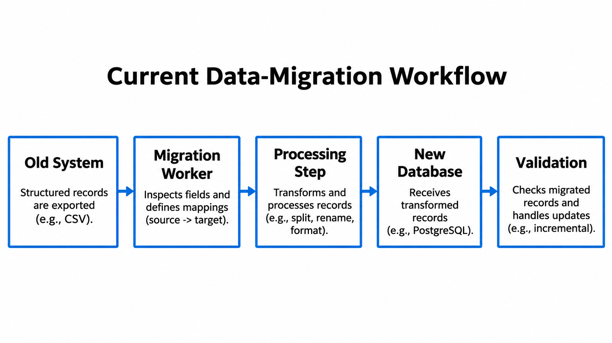

**Author:** Ibsan Hossain 

**Course:** CSC 59866 

**Selected project and option:** B2 - Reliable Data Exchange for Integrated Justice Records; generalized as a data-migration system 

**Current assignment:** 2 

**Friday commit deadline:** November 13, 2026  
**Monday presentation:** November 16, 2026  
**Last updated:** November 13, 2026 

**Document status:** Revised 

# **Progress note** 

For Assignment 2, I turned the problem from Assignment 1 into a set of specific requirements for the proposed data-migration system. I defined the main functions the system should provide, two correctness rules, and a proposed performance target that can be tested later. I also added an ordinary input/output example, an unsuccessful case, assumptions, and constraints. In Section 3, I compared a simple single-worker approach, a custom multi-worker approach, and Apache Spark as a distributed-processing alternative. I have not selected the final design yet because that decision belongs in Assignment 3. The main issue I still need to investigate is how migration work should be divided among workers without adding too much overhead or affecting correctness. My next step is to use the architecture and feasibility work in Assignment 3 to make that choice.
# **Contents** 

- <u>1 Problem research and scope</u> 

- <u>2 Requirements and system specification</u> 

- <u>3 Alternatives and selected solution</u> 

- <u>4 Architectural design</u> 

- <u>5 Component design and interfaces</u> 

- <u>6 Data structure design</u> 

- <u>7 Algorithm design and execution</u> 

- <u>8 Failures and security</u> 

- <u>9 Implementation and feasibility</u> 

- <u>10 Testing and verification</u> 

- <u>11 Operation maintenance and future work</u> 

- <u>12 Revision history and references</u> 

# **1 Problem research and scope** 

## **Problem and affected people:** 

The problem I am investigating is how to move a large amount of structured data from an older system into a replacement system quickly and correctly when the two systems may organize their data differently and the original data may continue changing during the migration. The people most directly affected are employees responsible for migration work, database administrators, developers, and data engineers. Organizations are also affected because the migrated records may support important daily operations, reporting, auditing, and other business functions. 

The Los Angeles County Sheriff’s Department Integrated Justice Information System opportunity provides a real example. The County plans to replace older jail-management systems while preserving historical and active records. Its statement of work requires data mappings, transformation logic, conversion routines, an initial full upload, incremental catch-up migrations, validation, reconciliation, and an audit trail. 

<u>Los Angeles County Sheriff’s Department — Integrated Justice Information System, Exhibit A: Statement of Work</u> 

|**Stakeholder**|**Current task**|**Main need**|
|---|---|---|
|Migration employee or operator|Move structured records from an<br>old system to a replacement<br>system|A clear and controlled migration<br>process|
|Database administrator|Check and protect destination data|<sup>Correct and complete migrated</sup><br>records|
|Developer or data engineer|Define mappings, transformations,<br>andmigration logic|A process that is understandable<br>andrepeatable|
|Organization replacing a system|Move to the new system without<br>losing important information|Accurate data and less repeated<br>migration work|


# **Current workflow:** 

A representative migration begins by exporting structured data from the old system. A migration employee or developer inspects the source fields and determines how they correspond to the fields expected by the new system. Required transformations are defined, the data is processed and loaded into the destination, and the migrated records are checked. If records are incorrect or the original data changes before the final cutover, some migration work may need to be repeated. 

The difficulty occurs when the old and new schemas do not match directly, when the amount of data is large enough that processing becomes slow, or when source records change after part of the migration has already been completed. 

# **Concrete scenario:** 

**Illustrative scenario, not an observed incident:** Suppose an organization needs to migrate five million employee records. The old file contains employee_number, full_name, and hire_date, while the new system expects employee_id, first_name, last_name, and start_date. The migration worker must decide how these fields correspond and how a combined name field should be converted into separate fields. 

Normally, the mapping is correct, the records are processed, and the destination receives the expected data. The problem appears if a field is mapped incorrectly, a very large dataset takes too long to process through one path, or source records change after they have already been migrated. The destination may then contain incorrect or outdated information, causing the technical team to repeat part of the migration. 

# **Evidence:** 

**Documented evidence:** The LA County statement of work requires an initial full data upload, multiple incremental catch-up migrations, record- and field-level validation, reconciliation evidence, mappings, transformation logic, and an audit trail. This supports the claim that real migration work involves schema differences, validation, and later updates rather than only copying data once. 

Apache Spark is an existing distributed data-processing approach that helps me understand the part of the problem involving large workloads. Its documentation describes a driver that coordinates executor processes and divides a larger job into tasks that can be processed in parallel. I am not claiming that my project will reproduce Spark. It is an existing approach that shows how large processing work can be divided among multiple workers. 

<u>Apache Spark — Cluster Mode Overview</u> 

# **Assumptions:** 

The concrete five-million-record employee example is an illustrative scenario rather than a measured case from LA County. I am assuming that the first planned version of the project can focus on structured file input, beginning with CSV, and a known destination schema. I am also assuming that synthetic data will be sufficient for design and later testing, so no real LA County records are required. Another assumption is that the project can be designed around multiple workers even if development and later testing use processes or services on one physical computer. These assumptions will be refined as the later design assignments define requirements, architecture, and evaluation. 

# **Six-week contribution:** 

During this six-week design period, I will investigate and define the bounded core migration capability that the Semester II system will later implement. The focus is the path from a structured source file to a mapped destination schema, followed by dividing a large migration into smaller units of work that can be assigned to multiple workers and eventually loaded into a destination database. This semester's contribution is to make that capability precise enough to guide implementation by documenting the problem, requirements, possible approaches, architecture, data and algorithm behavior, failure conditions, and the planned way to judge correctness and performance. 

The bounded question is not whether I can recreate every feature of an enterprise migration platform. It is how a general-purpose migration tool should combine schema mapping with distributed work division while keeping the destination data correct. 

# **Semester II scope:** 

The larger Semester II goal is to implement the working web-based data-migration product described in the Problem Understanding Paper. A user will be able to provide structured source data, map source fields to a destination schema, start the migration, and have the workload divided among multiple workers before the transformed records are loaded into PostgreSQL. The completed project is also intended to include migration monitoring and file-based change detection so that later source versions can identify new or changed records without repeating all unchanged work. 

CSV will be the initial structured input format. The design should keep input parsing separate enough that another structured format, such as JSON, can be added later without redesigning the entire migration process. 

# **Exclusions:** 

- Real LA County records and development of the complete LA County justice system. 

- Support for every possible database, file type, or transformation language. 

- Enterprise authentication and production cloud deployment. 

- Multi-datacenter operation or claims that a classroom design represents production-scale fault tolerance. 

- A full transaction-log Change Data Capture platform such as Debezium. 

- Completing the full Semester II implementation as part of Assignment 1. 




*Figure 1. Current data-migration workflow from an old system to a new database.*

# **2 Requirements and system specification**

The requirements below describe what the completed system should be able to do without deciding exactly how it will be implemented. **F** means functional requirement, **C** means correctness requirement, and **Q** means quality requirement. The acceptance checks are planned checks, not completed results.

|**ID**|**Required behavior and conditions**|**Acceptance check**|**Design and test reference**|
|---|---|---|---|
|F1|The system must accept a valid CSV file with a header row and identify the source fields so they can be mapped. If the file cannot be read as the supported format, the migration should not begin.|Upload a valid CSV and confirm that its fields are identified. Then provide an invalid file and confirm that it is rejected before migration starts.|To be added in later assignments.|
|F2|Before migration begins, the user must be able to map required source fields to the fields expected by the destination schema.|Using the employee example, map `employee_number` to `employee_id`, the name information to the destination name fields, and `hire_date` to `start_date`. Confirm that the reviewed mapping matches the user's selections.|To be added in later assignments.|
|F3|After a valid mapping is confirmed, the system must process source records and produce destination records that follow the destination schema. It must also identify failed records.|Use a small synthetic dataset with known expected output and compare the produced records and failure count with the expected results.|To be added in later assignments.|
|F4|The user must be able to view migration status and a final summary containing total, completed, and failed records.|Run a controlled migration and confirm that the progress information changes while work is processed and that the final totals match the recorded outcomes.|To be added in later assignments.|
|F5|When a newer version of previously migrated source data is provided, the completed system should identify new or changed records so unchanged records do not need to be processed again.|Use an original synthetic file and a second version with an unchanged record, a changed record, and a new record. Confirm that only the changed and new records are selected for reprocessing.|To be added in later assignments.|
|C1|Every record reported as successfully migrated must match the approved mapping and transformation rules.|Use a small dataset with known expected output and compare every successful destination record with the expected values.|To be added in later assignments.|
|C2|If a unit of migration work fails, it must not be reported as successfully completed or leave only part of that unit recorded as successful.|Introduce a controlled failure during one unit of work and inspect both the status and destination data for that unit.|To be added in later assignments.|
|Q1|**Proposed target:** On the same local test setup, using the same 100,000-record synthetic CSV, mapping, and transformations, a multi-worker configuration should achieve at least 25% higher throughput in records per second than the one-worker baseline while still satisfying C1 and C2. The 25% value is an initial proposed target and may be revised after the baseline is measured.|Run the same migration with one worker and with multiple workers. Measure records processed per second, compare the results, and verify correctness. This target has not been measured yet.|Proposed target; measurement details will be added later.|

## **Inputs and outputs**

An ordinary input would be:

```text
employee_number,full_name,hire_date
E101,Ava Chen,2021-05-10
E102,Marcus Lee,2020-09-01
```

Using the example mapping, the expected destination data would be:

```text
employee_id,first_name,last_name,start_date
E101,Ava,Chen,2021-05-10
E102,Marcus,Lee,2020-09-01
```

An unsuccessful case would occur if the destination requires `employee_id`, but the user does not map any source field to that required field. The system should identify the missing required mapping and prevent the migration from starting instead of producing incomplete destination records.

## **Assumptions**

- Initial input files are CSV files with a header row.
- Each source record has a non-empty key that can identify the record across versions.
- The destination schema and required fields are known before mapping begins.
- The first version supports a limited set of transformations such as renaming fields, splitting a value, and formatting dates.
- Synthetic data can represent normal, error, and changed-record cases without private production data.
- The proposed Q1 target may be revised after a baseline measurement.

## **Constraints**

- The project is completed by one student and must remain small enough to design, build, and evaluate within the course.
- CSV is the first supported input format.
- PostgreSQL is the planned destination database.
- Development and evaluation must be possible on the available local computer.
- Multiple worker processes may run on one computer, but this will not be described as equivalent to a production multi-machine system.
- Only public documentation and synthetic data will be used.
- Production cloud deployment, enterprise authentication, and a full transaction-log Change Data Capture system are outside scope.


# **3 Alternatives and selected solution**

For Assignment 2, I am comparing possible ways the migration system could process its data. The final design choice will be made in Assignment 3 after the architecture and feasibility work.

|**Approach and source**|**Useful behavior**|**Limitation**|**Evidence or assumption**|
|---|---|---|---|
|**Single-worker ETL baseline**|One worker reads, transforms, and loads the records in order. This is simple to understand and gives the project a baseline for performance comparison. PostgreSQL transactions can also help make destination updates reliable.|One worker handles all processing, which may become slow for large datasets. Separate logic is still needed for change detection.|PostgreSQL documents transactions as groups of operations that complete together or have no effect if not completed. The performance limitation must be measured later.|
|**Custom multi-worker migration system**|The migration can be divided into smaller jobs and processed by several workers at the same time. Field mapping, progress monitoring, and file-based change detection can remain part of one focused application.|The design must handle job distribution, failures, duplicate work, coordination, and job size. The performance benefit has not yet been measured.|Apache Spark shows that dividing larger jobs into tasks and coordinating worker processes is an established approach. Applying a smaller custom version is still a proposed design.|
|**Apache Spark**|Spark already supports parallel processing and structured data and could handle the large-data processing portion of the project.|Spark is a general-purpose processing framework rather than the complete migration product. Field mapping, progress behavior, destination rules, and file-based change tracking still need separate application logic.|Apache Spark documentation describes executors, tasks, and structured-data processing. The scope judgment is based on this project's constraints.|

## **Comparison against the same requirements**

|**Requirement area**|**Single-worker baseline**|**Custom multi-worker system**|**Apache Spark**|
|---|---|---|---|
|F1-F2: CSV input and field mapping|Can support both.|Can support both.|Needs separate application logic around Spark.|
|F3: processing|Can support, but all work is sequential.|Can support while dividing work among workers.|Strong support for parallel structured-data processing.|
|F4: progress and final summary|Must be added.|Can be designed into the migration system.|User-facing migration progress still needs separate logic.|
|F5: changed-record detection|Must be added separately.|Can be included in the file-based workflow.|Must be added separately for uploaded CSV files.|
|C1-C2: correctness and failure behavior|Simpler to coordinate; database transactions can help.|Requires careful worker coordination.|Migration-specific destination rules still need to be designed.|
|Q1: throughput improvement|Baseline only.|Intended to improve throughput; must be measured.|Designed for parallel processing, but may add unnecessary complexity.|

[PostgreSQL - Transactions](https://www.postgresql.org/docs/current/tutorial-transactions.html)

[Apache Spark - Cluster Mode Overview](https://spark.apache.org/docs/latest/cluster-overview.html)

[Apache Spark - Spark SQL, DataFrames and Datasets Guide](https://spark.apache.org/docs/latest/sql-programming-guide.html)

Debezium is also relevant to F5 because its PostgreSQL connector demonstrates detecting later database changes after an initial snapshot. It is not a complete candidate for this project's uploaded-CSV workflow because a CSV file does not provide a database transaction log for Debezium to monitor.

[Debezium - PostgreSQL Connector](https://debezium.io/documentation/reference/stable/connectors/postgresql.html)

## **Current direction**

I am not making the final design choice in Assignment 2. The **custom multi-worker approach** is currently the leading direction because it most directly matches the goal of building a web-based migration product while still allowing me to investigate how work is divided across workers.

The **single-worker approach** will remain the baseline for later comparison. **Apache Spark** remains an existing distributed alternative. The final approach will be selected in Assignment 3 after the architecture and feasibility questions are examined.

## **Decision 1**

**Work to come - Assignment 3.**

## **Decision 2**

**Work to come - Assignment 3.**


**4 Architectural design Work to come - Assignment 3.** 

**5 Component design and interfaces Work to come - Assignment 3.** 

**6 Data structure design** 

**Work to come - Assignment 4.** 

**7 Algorithm design and execution** 

**Work to come - Assignment 4.** 

**8 Failures and security** 

**Work to come - Assignment 4.** 

**9 Implementation and feasibility** 

**Work to come - later assignments.** 

**10 Testing and verification** 

**Work to come - later assignments.** 

**11 Operation maintenance and future work** 

**Work to come - later assignments.** 

**12 Revision history and references** 

|**Revision date**|**Change to my design**|**Reason and evidence**|
|---|---|---|
|November 6, 2026|Created the initial Assignment 1 design document for B2 with the affected people, current workflow, concrete scenario, evidence, assumptions, bounded contribution, Semester II goal, exclusions, table, image, and sources.|Assignment 1 required the problem and project boundary to be understandable before later requirements and design work began.|
|November 13, 2026|Added the initial requirements and system specification in Section 2 and drafted the alternatives comparison in Section 3. Added stable requirement IDs, acceptance checks, examples, assumptions, constraints, a proposed quality target, and additional technical sources.|Assignment 2 requires observable requirements and a comparison of possible approaches before the final design choice in Assignment 3.|

|**Open question**|**Why it matters**|**Next action**|
|---|---|---|
|How should a large migration be divided among multiple workers without adding too much coordination overhead or producing incorrect destination data?|The way work is divided may affect both the Q1 performance target and the C1/C2 correctness rules.|During Assignment 3, compare possible worker and job-distribution designs before selecting the architecture.|

## **Assistance and reuse:** 

This document is based on my B2 Problem Understanding Paper, the course provided design template, and the Software Project Design Handbook. ChatGPT was used to help organize and draft the Assignment 2 requirements, alternatives comparison, and Markdown formatting. No implementation results or performance measurements are claimed in this Assignment 2 draft. 

## **References** 

1. Los Angeles County Sheriff’s Department. Integrated Justice Information System - Exhibit A: Statement of Work, RFP 712-SH. Supports the problem evidence concerning mappings, transformation, full and incremental migration, validation, reconciliation, and auditing. 

https://lasd.org/wp-content/uploads/2026/10/Solicitations_RFP712-SH_4_ExhA_100126.pdf 

2. Apache Spark. Cluster Mode Overview. Supports the distributed-processing concept of a driver coordinating executor processes and larger jobs being divided into tasks. 

https://spark.apache.org/docs/latest/cluster-overview.html 

3. Apache Spark. Spark SQL, DataFrames and Datasets Guide. Supports structured-data processing using Spark. 

https://spark.apache.org/docs/latest/sql-programming-guide.html 

4. PostgreSQL Global Development Group. Transactions. Supports the use of all-or-nothing groups of database operations when reasoning about reliable destination updates. 

https://www.postgresql.org/docs/current/tutorial-transactions.html 

5. Debezium. Debezium Connector for PostgreSQL. Supports the concept of an initial snapshot followed by later change detection and shows why database CDC differs from file-based change tracking. 

https://debezium.io/documentation/reference/stable/connectors/postgresql.html 

6. CSC 59866 course materials. Software Project Design Handbook and Design Document Template, Fall 2026. Used for the Assignment 2 structure, requirements format, comparison guidance, and weekly design process.
