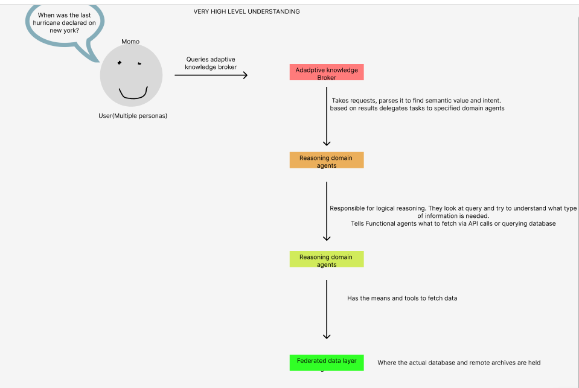

# AI-Driven National Synthesis Hub for Convergent Disaster Research and Intelligence


## Problem and scope
Disasters can take place any time. It's important to be prepared for, properly respond to, and recover from said disasters. The problem is disaster information is spread across many repositories , fragmented known as silos. These data silos often compliment each other or further elaborate on each other but alone they aren't as useful. The emergency responders, disaster scientist, and the general public affected by these disasters may not have the time to consolidate all these fragmented information. The general public especially may not have the means to these resources locked behind universities(i.e requiring a scholarly account/email.) or understand the jargon. The aim of this project is to democratize technology by providing a plain language query interface with real-time accurate information


For this project, my scope will be narrowed to disasters that primarily affect New York (i.e Floods, hurricane, heat waves).


### What this version leaves out

- Limited to disasters that primarily affect New York and related archives (floods)
- Persona tailored responses
- agent tiers
- no live api's

**Author:** Mohamed Kamagate  
**Course:** CSC 59866  
**Selected project and option:** 10  Category III: AI-Driven National Synthesis Hub for Convergent Disaster Research and Intelligence   
**Current assignment:** 1
**Friday commit deadline:**  November 6 2026, at 11:59 p.m. New York time  
**Monday presentation:**  November 9 2026, at 6:30 p.m. New York time  
**Last updated:** 11/10 
**Document status:** Proposed


## Progress note


Initial start to the assignment. Developed an unuderstanding of how the vast amount of ontology knowledge may affect groups of people in terms of searchability, comprehension, and time management. Also learnt about the proposed solution given by the docuuument. Deals with four tier agentic architecture. The most newest update is cleaning up redundanciies for the week 1 assignment, remodeling the workflow so it doesn't include the proposed solution and demonstrates what is commonly happening instead. 


*11/18*
Narrowed down the approach for six week contribution; Will work with sources that does not require live Api calls and instead will work with static collections of data from sources like FEMA.gov and NYC emergency management. No need for AI tiers but may at best be considered for semester 2 scope. For now six week contribution will involve a RAG tier system, with multiple public documentation(around 20). My inventory next step would be to find specific material that would be useful to add to the vector database, around 20 material. 

*11/19*
Modified required behavior. F2, previously requiring persona tailored response is no longer a requirement and is omitted for now or may be deferred to semester II. F2's new requirement is needing the response to be in plain language instead for one user. The one user in question would be the general public, specifically those who are affected by floods or or in flood prone zones and would like to prepare.

Added more specific test questions that includes acceptable answers, the source passage you can find the answer, and whether or not it can be answered in section 2 

## Contents

- [1 Problem research and scope](#1-problem-research-and-scope)
- [2 Requirements and system specification](#2-requirements-and-system-specification)
- [3 Alternatives and selected solution](#3-alternatives-and-selected-solution)
- [4 Architectural design](#4-architectural-design)
- [5 Component design and interfaces](#5-component-design-and-interfaces)
- [6 Data structure design](#6-data-structure-design)
- [7 Algorithm design and execution](#7-algorithm-design-and-execution)
- [8 Failures and security](#8-failures-and-security)
- [9 Implementation and feasibility](#9-implementation-and-feasibility)
- [10 Testing and verification](#10-testing-and-verification)
- [11 Operation maintenance and future work](#11-operation-maintenance-and-future-work)
- [12 Revision history and references](#12-revision-history-and-references)
## Stakeholders


*Potential Stakeholders*
* Under-resourced communities
* Disaster science researchers
* Emergency Managers/First responders

| Stakeholders | Level of impact | Reasoning| 
|---|---| ---|
| General Public/Victims to disasters | High | Disasters affect them directly. These communities may be overlooked. Lack of access to resources that apply to them.
| Disaster science researchers | Medium-high | Actively resource subject matter pertaining to disasters. Requires different domain knowledge to fully understand
| Emergency Managers/First responders | Medium | Has a team to spread out the work require. 

(1)*General Public/Victims to disasters* “broaden access for under-resourced communities,” 
* Communities who are under-resourced include people in rural areas where much analysis arent done in there region, making GIS[^1] maps useless for them and not much documentation they can go off on. They can query the AI agents, asking for things like "What federal grants are available for repairing our specific type of bridge damage, and what documents do we need?" where the AI agent can fetch fema documents and make it easier to understand and interpret by the user.
[^1]: For context, GIS maps provide visual representations of spatial data. helps user understand geographic patterns and relationships. Urban areas tend to have advantage over rural ones. https://www.maplibrary.org/11436/6-scaling-challenges-in-urban-vs-rural-mapping/ 
* Low-income communities in general are most affected by these disasters[^2].. They’re located in flood prone zones, bad urban infrastructure, and are often left out of academic loop when new works are published. Since traditional disaster data is hidden behind paywalls or especially  locked behind complex academic jargon, a plain language query ai engineering hub such as this project provides accurate, and clear guidance on what to do and what to expect. LLMs can be used, but they fall victim to halluncinations and unreliable sources. This project utilizes a federate data layer that enables source independence, allowing responses to be tracked to their original source proving to be accurate. 
[^2]:  An example of this https://nysclimateimpacts.org/explore-the-assessment/case-studies/hurricane-ida-vulnerabilities-in-new-york-city/#:~:text=Left%2C%20the%20basement%20living%20space%20in%20Brooklyn%2C,federal%20assistance%20because%20of%20their%20immigration%20status

(2) *Disaster science researchers*  “support training of the next generation of disaster researchers and practitioners”

* Disaster catastrophes are inherently complex. To fully extract real info and/or raw data, it requires a mix of domains between engineering and social science and physical science. Instead of learning these domains, a specialist can prioritize their respected field, and allow this platform to bridge the knowledge gap. 
* Disaster science researchers must also be able to cite deep historical literature that is accurate. A simple LLM can cause halluncinations and are difficult to cite properly. Search engines are helpful, but may take up too much of the researchers time. This platform provides accurate information that can be cited due to the federate data layer component. 

(3) Emergency Managers/First responders
* Must be able to make quick, accurate descions. Instead of scavenging multiple sources too get the best, accurate, real time information, this platform helps them save time and potentially lives. In addition, sources these stakeholders look at (such as  NYC open data, FEMA, etc.) would be included in the federate data layer. 

**Current workflow:** 
* User wants to do research on niche disaster topic
* Uses search engine first. Sources provided may be too vague or loosely connected to user's query
* Uses an LLM as an alternative, which falls victim to halluncinations. User may be skeptical of the results.

<!-- Revision notes mention specific user question, Name the data sources and cite evidence that the intended user has trouble finding or interpreting them -->
**Current workflow(Revised 11/18):**
* User[Queens tenant. General public. Disaster victim. Apartment flood due to hurricane Ida] - Disaster related search["What financial help can I apply for, and what documents do I need?"]
* User wants to search up what financial help they can apply for and required documents needed for it. User starts with google search
* [Difficulty 1] Results lead to general news article about the event, or generic pages such as nyc.gov that branch out into multiple external links to other sites that may help.
* [Difficulty 2] User search leads to OpenFEMA, which hosts dense datasets. Yet user lacks the technical skills to extract the required info from the dataset. OpenFema mainly provides Api's and not PDFs a user can download
* User visits NYC emergency management and finds information about a different assistance program they may or may not qualify for.
* User visits FEMA that provides information about the same or additional assistance program they may or may not qualify. User takes note of findings from both sites
* User visits FloodNet that simulates the impact of the flood caused by hurricane ida. Takes note of this knowledge as supporting evidence for their application. 
* User stitches together gathered information and makes an actionable descion.
* Alternative: User uses an LLM to query his/her question. LLM provides a confident summary but citations can't be verified or missing.

*Assumed current tasks*: User must search the archives separately and collect citations manually

## Concrete Example
An emergency manager wants to know which neighborhoods were slowlest to recover and most impacted by past storms. The answer is spread across different archives. Structural damage data sits in an engineering collection, the  amount of aid received sits in a social-science collection. Each archives uses different terms and formats. Realistically she wouldn't be able to investigate all the possible sources, so she only relies on several sources. 

**Evidence:**   

University of delaware DRC hosts oldest archive of ontologist related works. The information may complex and less suited for non-researchers who are looking for accurate and clear guidance.

https://udspace.udel.edu/communities/bdc76090-7084-449f-a272-f6c7bdff1a5f/search


"68% of people who have experienced a disaster say they wish they had prepared differently."
https://www.unitedway.org/preparedness-survey-2026-snapshot


Because agencies collect data in inconsistent ways and keep it locked in silos, it is tough to plan ahead, respond quickly, or help communities recover from disasters.

https://www.preventionweb.net/news/increasing-national-resilience-through-open-disaster-data-initiative


**Six-week contribution:** *State the small capability you will demonstrate.*
Implement a RAG system. It'll be more static, the ai agent would query a vector database regarding flooding information in new york instead 

**Six-week contribution(Revised 11/18)**
For one New York flood event such as Hurricane Ida, the prototype retrieves relevant passages from a fixed collection of about 20 or so public documents from sources like FEMA.gov and NYC Emergency management. OpenFEMA, FloodNEt, and NYC Open data datasets are out of scope for this version since they require api calls. The prototype should be able to answer questions such as "What financial assistance was available after Ida, and what documents did it require?", and the result criteria would be every result/response to a query  provides a title, URL, and a collection date that links back to the source it retrieved the info from. For out of scope questions, the result criteria should be the system returns a response mentioning its limitations and provide no misleading text. 

*Boundary*: Only dealing with static retrieval over fixed collection. No live api calls, no agent tiers for this scope. 

**Semester II scope:** *Explain what the completed project will add.*
Design it to be more scalable to accept a variety of disaster archives. Implement the four tier agentic architecture.
**Exclusions:** May keep the domain narrow to disasters that affect New Yorkers primarily, the best example being floods. May refer to several api's and repositories instead of the vast amount availiable 

<!-- Add an actual image using a relative path, for example:


Figure 1. Explain what the workflow shows and why it matters.
Do not leave references to nonexistent images. -->

## 2 Requirements and system specification


| ID | Required behavior and conditions | Acceptance check | Design and test reference |
|---|---|---|---|
| F1 | The federated data layer must retrieve records from distributed  archives while tracking and displaying the exact source provenance.[^3]| Run a multi-archive data synthesis check and verify every factual claim in the final output[^4] includes a verifiable citation back to its original repository source (as suggested by partner). | Add as design develops |
|F2 | An emergency manager, disaster researcher or the general public can submit a plain-language query (e.g., requesting FEMA grant requirements or localized flood-risk data) and obtain persona tailored response to the query. | Submit three distinct queries, each pertaining to one of the 3 different personas. Inspect the response to see if matches the tone of the given persona. Accuracy decided by subtle differences in jargon. | Add as design develops |
| F3 | An unanswerable or out of scope query is handled safely | Submit a query the archive cannot answer (i.e. a flood event on a date that never occured). Pass if the response states the limitation, does not invent data, and suggests an alternative source. |
| C1 | No claim/response is returned without a source. | Run the prepared queries. Should be able to go to the provided source and verify it manually. | Add as design develops |
| Q1 | Response time of atleast 90% of queries that involves different domains should not surpass 5 second threshold. Will test with 10 or so queries. | Input a multi domain query and measure the speed of the output. | Proposed. Not yet measured, will update to measured when results from test has been received |
| Q2 | More than half, out of a sample size of 20 queries, should be met with an accurate response.  | Can either implement a confidence level to each response given by ai agent, or manually check the sources given each time for testing. |Proposed. Not yet measured, will update to measured when results from test has been received |


 *11/18 Revised*
 | ID | Required behavior and conditions | Acceptance check | Design and test reference |
|---|---|---|---|
| F1 | The federated data layer must retrieve records from distributed  archives while tracking and displaying the exact source provenance.[^3]| Run a multi-archive data synthesis check and verify every factual claim in the final output[^4] includes a verifiable citation back to its original repository source (as suggested by partner). | Add as design develops |
|F2 | An emergency manager, disaster researcher or the general public can submit a plain-language query (e.g., requesting FEMA grant requirements or localized flood-risk data) and obtain persona tailored response to the query. | Submit three distinct queries, each pertaining to one of the 3 different personas. Inspect the response to see if matches the tone of the given persona. Accuracy decided by subtle differences in jargon. | Add as design develops |
| F3 | An unanswerable or out of scope query is handled safely | Submit a query the archive cannot answer (i.e. a flood event on a date that never occured). Pass if the response states the limitation, does not invent data, and suggests an alternative source. |
| C1 | No claim/response is returned without a source. | Run the prepared queries. Should be able to go to the provided source and verify it manually. | Add as design develops |
| Q1 | Response time of atleast 90% of queries that involves different domains should not surpass 5 second threshold. Will test with 10 or so queries. | Input a multi domain query and measure the speed of the output. | Proposed. Not yet measured, will update to measured when results from test has been received |
| Q2 | More than half, out of a sample size of 20 queries, should be met with an accurate response.  | Can either implement a confidence level to each response given by ai agent, or manually check the sources given each time for testing. |Proposed. Not yet measured, will update to measured when results from test has been received |
[^3]: Knowing the origin of the source, which domain agents retrieved it, and prehaps a confidence score on how trustworthy the source is. Source provennance is essential to eliminate halluncinations. Also helps with accountability. 
[^4]: In general, RAG responses take in user queries, then augment it with its own prompt. Can enforce the LLM to pull in not only the text, but the source ID along with every response. 

**Required test set needed before implementing test**
1. Prepared queries. (i.e 1-2 queries that require accessing FEMA documentation, 1-2 queries pertaining to floods in small neighborhood/borough. in general place specific data. 1-2 cross domain queries such as one involving GIS skills, engineering, social science, etc. )

**Pass criteria (work in progress)**
1. Correctly cited sources that can be verified
2. Persona-matched responses seem aaccurate
3. Zero fabricated answers/halluncinations for out of scope query.


*11/19 Revised test set and pass criteria*

| ID |Question | In-scope | Source passage | Acceptable/Expected answer |
|---|---|---|---|---|
| T1 | What financial assistance was available after Hurricane Ida, and what documents did it require? | Yes | FEMA(https://www.fema.gov/fact-sheet/programs-and-assistance-approved-hurricane-ida-survivors, https://www.fema.gov/fact-sheet/faq-setting-record-straight-fema-assistance-hurricane-ida-ny and pdf file https://fema.gov/print/pdf/node/629092) | Program name(s), document list, source passage. A couple of acceptable program names: "FEMA’s National Flood Insurance Program", "U.S. Small Business Administration", "Hurricane Ida Relief Fund for Excluded New Yorkers:" |
|T2 | How do I apply for FEMA assistance after the flood caused by Ida, and what was the deadline? | Yes | FEMA(https://www.fema.gov/fact-sheet/programs-and-assistance-approved-hurricane-ida-survivors, https://www.fema.gov/fact-sheet/faq-setting-record-straight-fema-assistance-hurricane-ida-ny and pdf file https://fema.gov/print/pdf/node/629092) | Application methods, exact deadline as stated in the source(Monday, Dec. 6), and the source passage|
| T3 | How do I get flood alerts if I live in a basement apartment  | Yes | NY.gov and/or NYEM (https://www.nyc.gov/site/em/ready/be-ready-new-york.page)  | Sign up for Notify NYC and choose the basement apartment alert option. Must cite the official NYC page. |
| T4 | What’s the difference between a Flash Flood Watch and a Flash Flood Warning? | Yes | NY.gov and/or NYEM (https://www.nyc.gov/site/em/ready/flooding.page)  | A watch means conditions favor flash flooding but it isn’t certain or imminent. A warning means flash flooding is in progress, imminent, or highly likely. Anything along these lines. Also include source passage |
| T5 | Can renters get flood insurance? | Yes | FEMA or floodhelpny(https://floodhelpny.org/en/understanding-flood-insurance) | Should expect a "Yes". The page says all homeowners, renters, and business owners are eligible for flood insurance|
| T6 | What are some assistances I can get after experiencing hurricane Isaias | Not in scope. Hurricane Isais is in Florida | N/A | State limitations and the question being beyond scope.|

**Inputs and outputs:** Give an ordinary example and an unsuccessful example.
*Ordinary example*: Takes in user query as input, returns response to query as output. The response should have source provenance, and be tailored to the user's persona(may omit this part)
*Unsuccessful example*: Takes in query as input,  returns an inaccurate response, no source provenance, or failed to respond in time
**Assumptions:** Conditions you rely on and how to check them.

*Assumption 1:* Public API's and open archives remain publically availiable. (e.g., NOAA weather telemetry and NYC Open Data catch-basin logs) Doesn't requrie authentication token(subject to change) or paywall to reach the HTTPS endpoints.

*Assumption 2:* The schemas doesn't undergo major changes during the semester development window

*Way to check assumption 1*: Short, simple python script involving the requests library. Send HTTP get requests to all important endpoints and ensure the response status is 200. Should also return actual text.

*Way to check assumption 2*: Can review API documentation to see if actively going through change, can look at unique URLS and see if there was a change (i.e /api/v2 /api/v3/ etc)

**Constraints:** Limits on time, tools, data, and resources.
* Constraint on quantity of data being used. For now, 4 or more sources should be sufficient. 
* Hardwware constraints. Prototypep should be able to run on a decent laptop, shouldnt require high computation
* Data constraint, only using free an availiable data archives 


*Draft*
| Criterion | Single LLM instead of delegating tasks | Four tier agentic architecture | 
|---|---| ---|
| Handling a multi-domain required query | May not be as affective(unless testing says otherwise)  | Can delegate tasks to mitigate cross domain confusion |
| Performance | May yield better results. May perform faster due to not waiting on supporting ai agents | May perform slower due to consolidating ai agents | 
| Source Provenance consistency | May fall to hallucinations or inaccurate responses  |  Source provenance expected to remain consistent |


## 3 Alternatives and selected solution

*Required behavior* : 

| ID | Required behavior and conditions | Acceptance check | Design and test reference |
|---|---|---|---|
| F1 | When a user submits a plain-language query about Hurricane Ida in NYC, the system must retrieve relevant passages from the static 10-document collection and display each passage's document title, source URL, and collection date. | Run test queries and manually check if each response has a source provenance  | Add as design develops |
|F2 | A flood victim and/or a potential flood victim submits a quey in plain language, and receives a response in plain language | Submit a query, and manual check the response to see if there is no heavy jargon from the generated response | Add as design develops |
| F3 | When a user submits a query that cannot be answered form the 10-document collection, the system must state its limitations and must not generate unverifiable claims | Submit a query the archive cannot answer (i.e. a flood event on a date that never occured). Pass if the response states the limitation, does not invent data, and suggests an alternative source. |
| C1 | No claim/response is returned without a source. | Run the prepared queries. Should be able to go to the provided source and verify it manually. | Add as design develops |
| Q1 | Response time of atleast 90% of queries that involves different domains should not surpass 5 second threshold. Will test with 10 or so queries. | Input a multi domain query and measure the speed of the output. | Proposed. Not yet measured, will update to measured when results from test has been received |
<!-- Draft in Assignment 2; complete in Assignment 3. Compare at least two
approaches under the same requirements, including a simple baseline. -->

| Required behavior |Keyword Search +Metadata (Simple baseline) | Semantic Retrieval using RAG and LLM | Four tier agentic architecture | 
|---|---|---|---|
| F1 | Queries match keywords/tags and return matching document excerpts and links directly without generating a synthesized answer conducted by an LLM. Each text/passage should have their URL, collection date, and title as key values[^5] | The retrieval component searches the static document chunks and returns relevant passages along with their attached metadata (title, url, and collection date, overall source provennance). The prompt now gets augmented with this new information for the LLM.  LLM will generate a response while being enforced to return the passage it used url, title, collection date.   | Routes queries across agent tiers and live/external sources to retrieve records and attach provenance |
|F2 | Does not respond in plain-language. Only retrieves raw excerpts | Uses an LLM to help generate a response in plain language |  routes queries across specialized agents, and knowledge broker summarizes in plain language for user |
| F3 | If keywords produce a score near 0, hardcode application to return a message "not found in collection" |  | 2 |
| C1 | 1 | 2 | 3 |
| Q1 | 1. | 2 | 3 |
[^5]: {
        "text": (
            "To qualify for Housing Assistance, FEMA must confirm the applicant lived "
            "at the disaster-damaged home as their primary residence. Rental Assistance "
            "may be used to rent a house, apartment, manufactured home, recreational "
            "vehicle or other readily fabricated dwelling."
        ),
        "title": "Individuals and Households Program Fact Sheet - FEMA",
        "url": "https://www.fema.gov/sites/default/files/documents/fema_ia_individuals-households-program-fact-sheet_112024.pdf",
        "collection_date": "2026-11-19",
    },
**KeywordSearch existing methods**: 
* rank-bm25. Works by giving passages as list of words, and it scores it against a query. Scores based on rarity and term frequency. The highest scores will be the passage retrieved and cited based on what the query asked Alternative is SQLite FTS5:

**Semantic retrivial existing methods**: 
* Query becomes vector, system measures how close that vector is to each passage vector 


|  |Keyword Search (Simple baseline) | Semantic Retrieval using RAG system and vector database | Four tier agentic architecture | 
|---|---|---|---|
| Strengths | Zero chance for halluncinations | Prevents halluncionations and package response in plain language  | Prevents hallucinations and is useful for coordination. Can handle large scale archives and very scalable |
|Weakness | Returns raw excerpts user must read and interpret | Static database | Difficult implementation |


| Approach and source | Useful behavior | Limitation | Evidence or assumption |
|---|---|---|---|
| Simple baseline | Replace | Replace | Replace |
| Candidate alternative | Replace | Replace | Replace |

**Choice and reason:** Connect your choice to requirements and constraints.
**Picked**: RAG system

**Reasoning**: 
* Prevents hallucinations and provides source provenance which is a requirement of the project
* Works sufficiently well with time constraints. Four Tier Agentic architecture may take a considerable amount of time to implement
* Works well with a static database, no need for API calls
* 

### Decision 1

**Context and requirement:** Why is a choice needed?  
**Options:** Plausible alternatives.  
**Decision and reason:** What you selected and why.  
**Consequences:** Benefits, costs, and limitations.  
**Status and revisit condition:** Proposed or accepted; what might change it?

### Decision 2

**Context and requirement:** Replace.  
**Options:** Replace.  
**Decision and reason:** Replace.  
**Consequences:** Replace.  
**Status and revisit condition:** Replace.

## 4 Architectural design

<!-- Assignment 3. Show context and the main running programs and stores.
Embed a diagram from assets and retain editable source. Mermaid is optional. -->

**Boundary and outside participants:** Replace.

**Main parts and messages:** Explain responsibilities and labeled arrows.

**Where parts run:** Identify shared machines and dependencies.

**What I build reuse or simulate:** Replace.

## 5 Component design and interfaces

<!-- Assignment 3. A component can be a function or module in one program. -->

| Component | Responsibility | Input | Output or state change |
|---|---|---|---|
| Replace | Replace | Replace | Replace |

**Critical operation:** Name and purpose.

**Input:** Fields, types, allowed values, caller identity, and example.

**Output:** Fields, meanings, and example.

**Errors:** Conditions and appropriate caller actions.

**Repeated or overlapping calls:** Define the behavior.

## 6 Data structure design

<!-- Assignment 4. Explain information and meaning, not only storage syntax. -->

| Record or structure | Fields and example values | Relationships and rules | Persistence |
|---|---|---|---|
| Replace | Replace | Replace | What survives restart? |

**Ownership:** Identify the authoritative place for important facts.

**Invalid combinations:** Explain how they are prevented or detected.

**Retention and deletion:** Explain how long data is needed and what deletion changes.

## 7 Algorithm design and execution

<!-- Assignment 4. Replace this block with your pseudocode. Explain any step
that hides a guarantee, such as a protected write. -->

```text
ALGORITHM NAME(inputs)
    replace with input checks
    replace with decisions and state changes
    replace with output and error behavior
```

**Normal sequence:** Numbered steps or an explained sequence diagram.

**Interrupted sequence:** Failure point, surviving state, and recovery.

**Overlapping activity:** A conflicting execution and the mechanism that handles it.

**Resource estimate:** A small justified estimate if it affects the choice.

## 8 Failures and security

<!-- Assignment 4. Include three adverse scenarios and two misuse cases. -->

| Scenario | State that may survive | Expected behavior | Planned check |
|---|---|---|---|
| Replace | Replace | Replace | Replace |

**Selected adverse case for the prototype:** Name the case and why it matters.

**Excluded conditions and consequences:** Replace.

| Possible misuse and affected asset | Response | Remaining limitation and check |
|---|---|---|
| Replace | Replace | Replace |

## 9 Implementation and feasibility

<!-- Begin the feasibility experiment and path in Assignment 3; refine in Assignment 4;
report implementation status in Assignments 5–6. -->

**Minimal path:** The smallest useful end-to-end operation.

**Feasibility experiment:** Question, procedure, evidence, finding, design consequence.

**Current implementation:** Distinguish implemented, reused, simulated, blocked, and deferred.

**Run instructions and CI:** Link README.md and the recorded check.

## 10 Testing and verification

<!-- Plan in Assignment 4; add observations in Assignments 5–6. Expected outcomes
are not results. Link raw evidence. -->

| Test and requirement | Setup and procedure | Expected result | Status and evidence |
|---|---|---|---|
| T1 normal operation | Replace | Replace | Planned until run |
| T2 correctness rule | Replace | Replace | Planned until run |
| T3 adverse scenario | Replace | Replace | Planned until run |

**Baseline and comparison question:** Replace.

**Workload and environment:** Inputs, counts, timing, overlap, versions, machine, and reset.

**Measurements:** Units and populations, including unsuccessful operations.

**Actual results:** Explain what happened and what the evidence supports.

**Limits and next test:** State remaining uncertainty.

## 11 Operation maintenance and future work

<!-- Draft in Assignment 4; add operating instructions in Assignment 5;
complete in Assignment 6. -->

**Startup and diagnosis:** How to run the system and recognize a problem.

**Recovery:** Action, preserved state, and verification of recovery.

**One future change:** Effects on components, interfaces, data, and tests.

**Update and rollback:** How to change versions and recover a working configuration.

**Responsible design:** Connect people, data, access, reuse, and resource use to choices.

| Risk | Early sign | Response or fallback |
|---|---|---|
| Replace | Replace | Replace |

| Semester II milestone | Dependency | Completion evidence | Essential or optional |
|---|---|---|---|
| Replace | Replace | Replace | Replace |

## 12 Revision history and references

| Revision date | Change to my design | Reason and evidence |
|---|---|---|
| 11/10 | Scoping out inputs and outputs | Based on the proposed solution, this is the expected workflow |

| Open question | Why it matters | Next action |
|---|---|---|
| What is the best AI framework to handle the four tier architecture presented  | An AI framework provides standard patterns for agent communication, allowing one agent's structured JSON output to automatically trigger the next agent's input without custom glue code. | Start iteratively first before introducing the AI framework. Design a RAG system before making it more dynamic |

**Assistance and reuse:** Attribute sources, code, data, diagrams, and assistance under course policy.

### References
https://www.floodnet.nyc/flood-event-summaries
https://seagrant.sunysb.edu/floodinfonyc/#/local-reports

https://udspace.udel.edu/communities/bdc76090-7084-449f-a272-f6c7bdff1a5f/search

https://www.fema.gov/about/openfema/data-sets

https://data.cityofnewyork.us/Environment/FloodNet-Street-Flooding-Events-Measured-by-FloodN/aq7i-eu5q/about_data

https://www.drc.udel.edu/

<!-- Use descriptive links with author/organization, title, date/version, and
the claim supported. Also cite sources near relevant explanations. -->

### Supporting media and evidence

<!-- Link actual images, editable diagram files, logs, data, and optional video.
Explain each item's purpose. Avoid missing files and private-only paths. -->

### Final document check

- [ ] Terms and examples make the project understandable to a beginner.
- [ ] All twelve sections contain project-specific content.
- [ ] Requirements connect to design and tests.
- [ ] Architecture, components, data, and algorithms agree.
- [ ] Targets and plans are separate from observations.
- [ ] Tables, images, pseudocode, references, and evidence links render correctly.
- [ ] Images have alternative text, captions, and readable labels.
- [ ] Run instructions and evidence support reproduction.
- [ ] I am prepared to present my work and orally review the same selected group mate.
- [ ] Remaining work and maintenance needs are explicit.
- [ ] Instructional placeholders are removed from the final submission.
