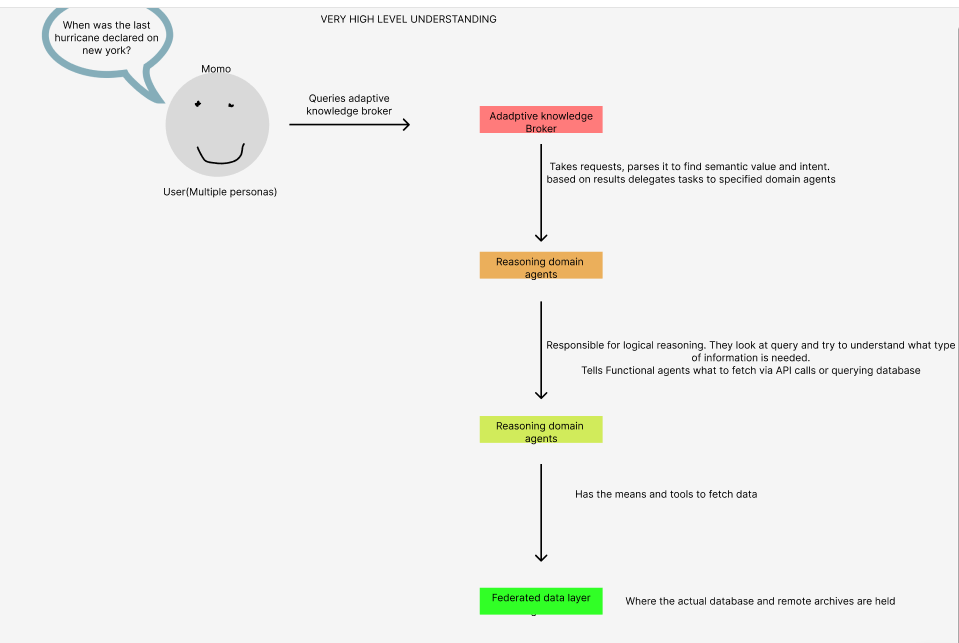

# AI-Driven National Synthesis Hub for Convergent Disaster Research and Intelligence

<!-- Copy this file into your project directory as DESIGN.md. Replace prompts
with your own explanations as sections become due. Create assets and evidence
directories for files you include. Remove instructional comments at final submission. -->
## Problem and scope
Disasters can take place any time. It's important to be prepared for, properly respond to, and recover from said disasters. The problem is disaster information is spread across many repositories , fragmented known as silos. These data silos often compliment each other or further elaborate on each other but alone they aren't as useful. The emergency responders, disaster scientist, and the general public affected by these disasters may not have the time to consolidate all these fragmented information. The general public especially may not have the means to these resources locked behind universities(i.e requiring a scholarly account/email.) or understand the jargon. The aim of this project is to democratize technology by providing a plain language query interface with real-time accurate information


For this project, my scope will be narrowed to disasters that primarily affect New York (i.e Floods, hurricane, heat waves).


### What this version leaves out

- Limited to disasters that primarily affect New York and related archives (floods)
- Considering not including personas in prototype

**Author:** Mohamed Kamagate  
**Course:** CSC 59866  
**Selected project and option:** 10  Category III: AI-Driven National Synthesis Hub for Convergent Disaster Research and Intelligence   
**Current assignment:** 1
**Friday commit deadline:**  November 6 2026, at 11:59 p.m. New York time  
**Monday presentation:**  November 9 2026, at 6:30 p.m. New York time  
**Last updated:** 11/10 
**Document status:** Proposed

<!-- Commit and push by Friday. Supply the exact commit identifier through the
course submission channel. Every Monday, present your own work and orally review
the same selected group mate for the remainder of the semester. No written
peer-review report, review link, or review transcript is required. -->

## Progress note

<!-- Write 100–150 words: changes, learning, main open issue, feedback addressed,
and next step. Link evidence when available. Update at each Friday deliverable. -->
Initial start to the assignment. Developed an unuderstanding of how the vast amount of ontology knowledge may affect groups of people in terms of searchability, comprehension, and time management. Also learnt about the proposed solution given by the docuuument. Deals with four tier agentic architecture. The most newest update is cleaning up redundanciies for the week 1 assignment, remodeling the workflow so it doesn't include the proposed solution and demonstrates what is commonly happening instead. 

## Contents

- [1 Problem research and scope](#1-problem-research-and-scope)
- [2 Requirements and system specification](#2-requirements-and-system-specification)
- [3 Alternatives and selected solution](#3-alternatives-and-selected-solution)
- [4 Architectural design](#4-architectural-design)
- [5 Component design and interfaces](#5-component-design-and-interfaces)
- [6 Data structure design](#6-data-structure-design)
- [7 Algorithm design and execution](#7-algorithm-design-and-execution)
- [8 Failures and security](#8-failures-and-security)
- [9 Implementation and feasibility](#9-implementation-and-feasibility)
- [10 Testing and verification](#10-testing-and-verification)
- [11 Operation maintenance and future work](#11-operation-maintenance-and-future-work)
- [12 Revision history and references](#12-revision-history-and-references)
## Stakeholders

*Potential Stakeholders*
* Under-resourced communities
* Disaster science researchers
* Emergency Managers/First responders

(1)*General Public/Victims to disasters* “broaden access for under-resourced communities,” 
* Communities who are under-resourced include people in rural areas where much analysis arent done in there region, making GIS[^1] maps useless for them and not much documentation they can go off on. They can query the AI agents, asking for things like "What federal grants are available for repairing our specific type of bridge damage, and what documents do we need?" where the AI agent can fetch fema documents and make it easier to understand and interpret by the user.
[^1]: For context, GIS maps provide visual representations of spatial data. helps user understand geographic patterns and relationships. Urban areas tend to have advantage over rural ones. https://www.maplibrary.org/11436/6-scaling-challenges-in-urban-vs-rural-mapping/ 
* Low-income communities in general are most affected by these disasters[^2].. They’re located in flood prone zones, bad urban infrastructure, and are often left out of academic loop when new works are published. Since traditional disaster data is hidden behind paywalls or especially  locked behind complex academic jargon, a plain language query ai engineering hub such as this project provides accurate, and clear guidance on what to do and what to expect. LLMs can be used, but they fall victim to halluncinations and unreliable sources. This project utilizes a federate data layer that enables source independence, allowing responses to be tracked to their original source proving to be accurate. 
[^2]:  An example of this https://nysclimateimpacts.org/explore-the-assessment/case-studies/hurricane-ida-vulnerabilities-in-new-york-city/#:~:text=Left%2C%20the%20basement%20living%20space%20in%20Brooklyn%2C,federal%20assistance%20because%20of%20their%20immigration%20status

(2) *Disaster science researchers*  “support training of the next generation of disaster researchers and practitioners”

* Disaster catastrophes are inherently complex. To fully extract real info and/or raw data, it requires a mix of domains between engineering and social science and physical science. Instead of learning these domains, a specialist can prioritize their respected field, and allow this platform to bridge the knowledge gap. 
* Disaster science researchers must also be able to cite deep historical literature that is accurate. A simple LLM can cause halluncinations and are difficult to cite properly. Search engines are helpful, but may take up too much of the researchers time. This platform provides accurate information that can be cited due to the federate data layer component. 

(3) Emergency Managers/First responders
* Must be able to make quick, accurate descions. Instead of scavenging multiple sources too get the best, accurate, real time information, this platform helps them save time and potentially lives. In addition, sources these stakeholders look at (such as  NYC open data, FEMA, etc.) would be included in the federate data layer. 

**Current workflow:** 
* User wants to do research on niche disaster topic
* Uses search engine first. Sources provided may be too vague or loosely connected to user's query
* Uses an LLM as an alternative, which falls victim to halluncinations. User may be skeptical of the results.

## Concrete Example
An emergency manager wants to know which neighborhoods were slowlest to recover and most impacted by past storms. The answer is spread across different archives. Structural damage data sits in an engineering collection, the  amount of aid received sits in a social-science collection. Each archives uses different terms and formats. Realistically she wouldn't be able to investigate all the possible sources, so she only relies on several sources. 

**Evidence:**   

University of delaware DRC hosts oldest archive of ontologist related works. The information may complex and less suited for non-researchers who are looking for accurate and clear guidance.

https://udspace.udel.edu/communities/bdc76090-7084-449f-a272-f6c7bdff1a5f/search


**Six-week contribution:** *State the small capability you will demonstrate.*
Implement a RAG system. It'll be more static, the ai agent would query a vector database regarding flooding information in new york instead 

**Semester II scope:** *Explain what the completed project will add.*
Design it to be more scalable to accept a variety of disaster archives. Implement the four tier agentic architecture.
**Exclusions:** May keep the domain narrow to disasters that affect New Yorkers primarily, the best example being floods. May refer to several api's and repositories instead of the vast amount availiable 

<!-- Add an actual image using a relative path, for example:


Figure 1. Explain what the workflow shows and why it matters.
Do not leave references to nonexistent images. -->

## 2 Requirements and system specification

<!-- Assignment 2. Explain required behavior before implementation methods.
Start with 3–5 functions, a correctness rule, and a quality target.
Complete design and test references during Assignments 2 and 3. -->

| ID | Required behavior and conditions | Acceptance check | Design and test reference |
|---|---|---|---|
| F1 | User-visible capability | Concrete check | Add as design develops |
| C1 | Rule that must remain true | A case that could violate it | Add as design develops |
| Q1 | Measure, unit, target, workload | Measurement procedure | Mark as target until measured |

**Inputs and outputs:** Give an ordinary example and an unsuccessful example.
*Ordinary example*: Takes in user query as input, returns response to query as output
*Unsuuuccessful example*: Takes in query as input,  returns in accurate response or failed to respond in time, 
**Assumptions:** Conditions you rely on and how to check them.

**Constraints:** Limits on time, tools, data, and resources.

## 3 Alternatives and selected solution

<!-- Draft in Assignment 2; complete in Assignment 3. Compare at least two
approaches under the same requirements, including a simple baseline. -->
*Solution 1: four tier agentic architectuuure* 
A user queries a adadptive knowledge broker. The knowledge broker breaks down the query into its semantic value tokens then delegates the tasks to specialized domain agent(s). The domain agent(s) have specialized knowledge on certain domains(i.e social science, physical science, policies etc.) They figure out what sources should be queiried and let functional agents do the physical work of actually calling the API's and checking the databases. These open Api's and databases are stored in the federate data layer. Lastly broke prepares the response back to the user.


| Approach and source | Useful behavior | Limitation | Evidence or assumption |
|---|---|---|---|
| Simple baseline | Replace | Replace | Replace |
| Candidate alternative | Replace | Replace | Replace |

**Choice and reason:** Connect your choice to requirements and constraints.

### Decision 1

**Context and requirement:** Why is a choice needed?  
**Options:** Plausible alternatives.  
**Decision and reason:** What you selected and why.  
**Consequences:** Benefits, costs, and limitations.  
**Status and revisit condition:** Proposed or accepted; what might change it?

### Decision 2

**Context and requirement:** Replace.  
**Options:** Replace.  
**Decision and reason:** Replace.  
**Consequences:** Replace.  
**Status and revisit condition:** Replace.

## 4 Architectural design

<!-- Assignment 3. Show context and the main running programs and stores.
Embed a diagram from assets and retain editable source. Mermaid is optional. -->

**Boundary and outside participants:** Replace.

**Main parts and messages:** Explain responsibilities and labeled arrows.

**Where parts run:** Identify shared machines and dependencies.

**What I build reuse or simulate:** Replace.

## 5 Component design and interfaces

<!-- Assignment 3. A component can be a function or module in one program. -->

| Component | Responsibility | Input | Output or state change |
|---|---|---|---|
| Replace | Replace | Replace | Replace |

**Critical operation:** Name and purpose.

**Input:** Fields, types, allowed values, caller identity, and example.

**Output:** Fields, meanings, and example.

**Errors:** Conditions and appropriate caller actions.

**Repeated or overlapping calls:** Define the behavior.

## 6 Data structure design

<!-- Assignment 4. Explain information and meaning, not only storage syntax. -->

| Record or structure | Fields and example values | Relationships and rules | Persistence |
|---|---|---|---|
| Replace | Replace | Replace | What survives restart? |

**Ownership:** Identify the authoritative place for important facts.

**Invalid combinations:** Explain how they are prevented or detected.

**Retention and deletion:** Explain how long data is needed and what deletion changes.

## 7 Algorithm design and execution

<!-- Assignment 4. Replace this block with your pseudocode. Explain any step
that hides a guarantee, such as a protected write. -->

```text
ALGORITHM NAME(inputs)
    replace with input checks
    replace with decisions and state changes
    replace with output and error behavior
```

**Normal sequence:** Numbered steps or an explained sequence diagram.

**Interrupted sequence:** Failure point, surviving state, and recovery.

**Overlapping activity:** A conflicting execution and the mechanism that handles it.

**Resource estimate:** A small justified estimate if it affects the choice.

## 8 Failures and security

<!-- Assignment 4. Include three adverse scenarios and two misuse cases. -->

| Scenario | State that may survive | Expected behavior | Planned check |
|---|---|---|---|
| Replace | Replace | Replace | Replace |

**Selected adverse case for the prototype:** Name the case and why it matters.

**Excluded conditions and consequences:** Replace.

| Possible misuse and affected asset | Response | Remaining limitation and check |
|---|---|---|
| Replace | Replace | Replace |

## 9 Implementation and feasibility

<!-- Begin the feasibility experiment and path in Assignment 3; refine in Assignment 4;
report implementation status in Assignments 5–6. -->

**Minimal path:** The smallest useful end-to-end operation.

**Feasibility experiment:** Question, procedure, evidence, finding, design consequence.

**Current implementation:** Distinguish implemented, reused, simulated, blocked, and deferred.

**Run instructions and CI:** Link README.md and the recorded check.

## 10 Testing and verification

<!-- Plan in Assignment 4; add observations in Assignments 5–6. Expected outcomes
are not results. Link raw evidence. -->

| Test and requirement | Setup and procedure | Expected result | Status and evidence |
|---|---|---|---|
| T1 normal operation | Replace | Replace | Planned until run |
| T2 correctness rule | Replace | Replace | Planned until run |
| T3 adverse scenario | Replace | Replace | Planned until run |

**Baseline and comparison question:** Replace.

**Workload and environment:** Inputs, counts, timing, overlap, versions, machine, and reset.

**Measurements:** Units and populations, including unsuccessful operations.

**Actual results:** Explain what happened and what the evidence supports.

**Limits and next test:** State remaining uncertainty.

## 11 Operation maintenance and future work

<!-- Draft in Assignment 4; add operating instructions in Assignment 5;
complete in Assignment 6. -->

**Startup and diagnosis:** How to run the system and recognize a problem.

**Recovery:** Action, preserved state, and verification of recovery.

**One future change:** Effects on components, interfaces, data, and tests.

**Update and rollback:** How to change versions and recover a working configuration.

**Responsible design:** Connect people, data, access, reuse, and resource use to choices.

| Risk | Early sign | Response or fallback |
|---|---|---|
| Replace | Replace | Replace |

| Semester II milestone | Dependency | Completion evidence | Essential or optional |
|---|---|---|---|
| Replace | Replace | Replace | Replace |

## 12 Revision history and references

| Revision date | Change to my design | Reason and evidence |
|---|---|---|
| 11/10 | Scoping out inputs and outputs | Based on the proposed solution, this is the expected workflow |

| Open question | Why it matters | Next action |
|---|---|---|
| What is the best AI framework to handle the four tier architecture presented  | An AI framework provides standard patterns for agent communication, allowing one agent's structured JSON output to automatically trigger the next agent's input without custom glue code. | Start iteratively first before introducing the AI framework. Design a RAG system before making it more dynamic |

**Assistance and reuse:** Attribute sources, code, data, diagrams, and assistance under course policy.

### References
https://www.floodnet.nyc/flood-event-summaries
https://seagrant.sunysb.edu/floodinfonyc/#/local-reports

https://udspace.udel.edu/communities/bdc76090-7084-449f-a272-f6c7bdff1a5f/search

https://www.fema.gov/about/openfema/data-sets

https://data.cityofnewyork.us/Environment/FloodNet-Street-Flooding-Events-Measured-by-FloodN/aq7i-eu5q/about_data

https://www.drc.udel.edu/

<!-- Use descriptive links with author/organization, title, date/version, and
the claim supported. Also cite sources near relevant explanations. -->

### Supporting media and evidence

<!-- Link actual images, editable diagram files, logs, data, and optional video.
Explain each item's purpose. Avoid missing files and private-only paths. -->

### Final document check

- [ ] Terms and examples make the project understandable to a beginner.
- [ ] All twelve sections contain project-specific content.
- [ ] Requirements connect to design and tests.
- [ ] Architecture, components, data, and algorithms agree.
- [ ] Targets and plans are separate from observations.
- [ ] Tables, images, pseudocode, references, and evidence links render correctly.
- [ ] Images have alternative text, captions, and readable labels.
- [ ] Run instructions and evidence support reproduction.
- [ ] I am prepared to present my work and orally review the same selected group mate.
- [ ] Remaining work and maintenance needs are explicit.
- [ ] Instructional placeholders are removed from the final submission.