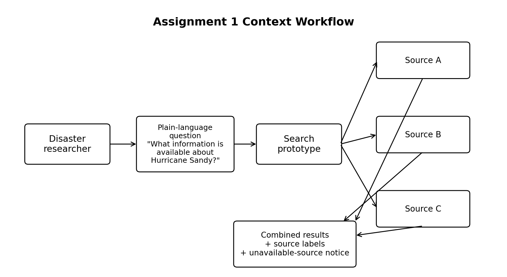
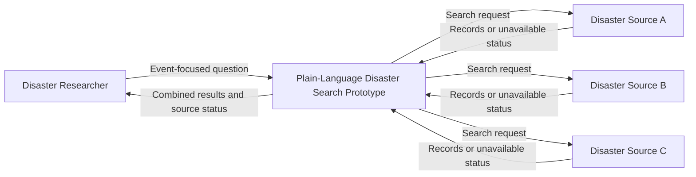
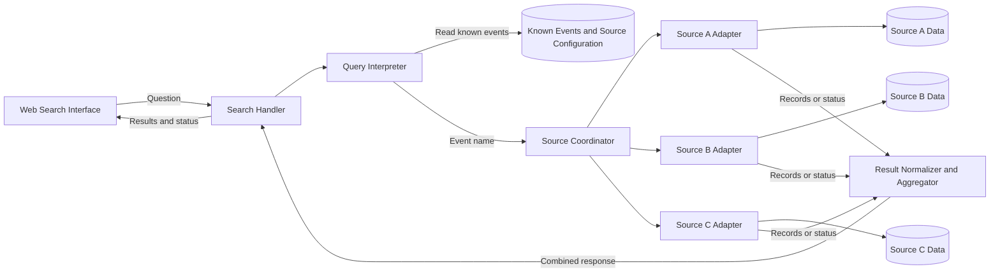

# Plain-Language Disaster Archive Search Design

**Author:** Raed Jaber  
**Course:** CSC 59866  
**Selected project and option:** A08 — Plain-Language Search Across Disaster Data Archives, based on NSF Project 10 (Award 2609535)  
**Current assignment:** 3 — Architecture and component interfaces  
**Sunday commit deadline:** November 22, 2026, at 11:59 p.m. New York time  
**Monday presentation:** November 23, 2026, at 6:30 p.m. New York time  
**Last updated:** November 22, 2026  
**Document status:** Revised

## Progress note

For Assignment 3, I selected the simple rule-based event-name approach for the six-week prototype and kept spaCy as a future option if the supported question set expands. I made this choice after a small feasibility experiment using twelve event-focused questions covering six known disaster events. The rule-based extractor identified the expected event in all twelve supported cases and correctly rejected three unsupported questions. I also revised the design to keep the project focused on one working search product rather than the full DISCAT 2.0 system. This version adds the system architecture, component responsibilities, a `search_event` interface, and the smallest implementation path. My main remaining risk is how closely simplified source adapters will represent real disaster archives. Next I will define the data records, failure behavior, and planned tests.

## Contents

- [1 Problem research and scope](#1-problem-research-and-scope)
- [2 Requirements and system specification](#2-requirements-and-system-specification)
- [3 Alternatives and selected solution](#3-alternatives-and-selected-solution)
- [4 Architectural design](#4-architectural-design)
- [5 Component design and interfaces](#5-component-design-and-interfaces)
- [6 Data structure design](#6-data-structure-design)
- [7 Algorithm design and execution](#7-algorithm-design-and-execution)
- [8 Failures and security](#8-failures-and-security)
- [9 Implementation and feasibility](#9-implementation-and-feasibility)
- [10 Testing and verification](#10-testing-and-verification)
- [11 Operation maintenance and future work](#11-operation-maintenance-and-future-work)
- [12 Revision history and references](#12-revision-history-and-references)

---

## 1 Problem research and scope

### Problem and affected people

The primary user for this project is a **disaster researcher** who needs to find information that may be stored across separate disaster-data archives.

The larger NSF Project 10 also identifies emergency managers and policy stakeholders as intended users of DISCAT 2.0, but the first prototype focuses on the researcher's search task.

NSF Award 2609535 describes DISCAT 2.0 as a planned system that connects existing disaster archives, makes it easier to ask questions in plain language, and includes a federated data layer.

My project takes one small capability from that larger idea: an event-focused question should return useful, source-labeled results from more than one disaster-data source.

https://www.nsf.gov/awardsearch/show-award?AWD_ID=2609535

### Current workflow

**Assumption to verify:** A disaster researcher who needs information from several independent archives may currently have to identify relevant sources, open them separately, adapt the search to each source, inspect results in different formats, and combine the useful findings manually.

For this design, I am not claiming that every disaster researcher follows exactly this workflow.

The NSF project establishes the broader need to connect existing disaster archives and make them easier to query. The exact current workflow for my intended user still needs additional evidence.

A simplified current workflow is:

1. The researcher identifies a disaster event and information need.
2. The researcher decides which archives may contain useful material.
3. The researcher searches each archive separately.
4. The researcher reviews results from the different sources.
5. The researcher manually connects the relevant information.

The difficulty occurs mainly in steps 2–5 because the sources are separate and may organize or describe their information differently.

### Concrete scenario

A disaster researcher wants to know what information is available about **Hurricane Sandy**.

A representative supported question is:

> What information is available about Hurricane Sandy?

In the assumed current workflow, the researcher may need to search several archives separately and then compare the results.

In the proposed prototype, the researcher enters the question once. The program identifies **Hurricane Sandy** as the event being searched, queries two or three simplified sources, and displays matching results together.

Every result shows its source.

The first prototype does **not** claim to understand arbitrary natural-language questions.

Its supported input is deliberately limited to event-focused English questions that name one disaster event.

The selected adverse case is that **one source is unavailable while the other sources are still available**.

The proposed behavior is to return the results received from available sources and clearly identify the source that could not be searched.

### Stakeholders and needs

| Stakeholder | Main need in this project | Current concern or difficulty |
| :--- | :--- | :--- |
| Disaster researcher | Find related disaster information without repeating the same search across several sources | Relevant information may be separated across independent archives |
| Emergency manager or policy stakeholder | Understand where returned information came from | Results need clear source attribution; this is a secondary user for the first prototype |
| Data repository or archive owner | Keep its information identifiable as coming from that source | Combined results should not hide or change source attribution |

### Evidence and assumptions

**Documented evidence:** NSF Project 10 states that DISCAT 2.0 will connect existing disaster archives, make it easier to ask questions in plain language, and include a federated data layer.

This establishes the larger problem area and motivates the capability being narrowed for this project.

https://www.nsf.gov/awardsearch/show-award?AWD_ID=2609535

**Existing approach:** The World Wide Web Consortium's Data Catalog Vocabulary (DCAT) Version 3 provides a standard model for describing datasets and data services.

DCAT helps explain how information from different catalogs can use a common structure for discovery.

https://www.w3.org/TR/vocab-dcat-3/

**Assumption:** Event-focused English questions that name one disaster event are a useful small input set for the first prototype. I have not yet validated this exact question format with an actual disaster researcher.

**Assumption:** Two or three simplified sources are enough to demonstrate the main discovery path during this six-week design period. This is a scope choice, not a claim about what a national system would require.

### Six-week contribution

The six-week contribution is one small end-to-end capability:

> A disaster researcher enters an event-focused plain-language question that names a disaster event. The prototype identifies the event, searches two or three simplified disaster-data sources, and returns one combined list of matching results with a source label for every result.

The normal case is that all configured sources respond.

The selected adverse case is that one source is unavailable.

The proposed behavior is to return results from the available sources and show a clear unavailable-source notice.

### Semester II scope

The larger Semester II goal is to turn the six-week working path into a more complete disaster-data discovery product.

Possible additions include:

- connecting to more realistic or public disaster-data sources,
- supporting a wider range of questions,
- improving result ranking and filtering,
- improving source and provenance information,
- and refining unavailable-source handling based on what is learned from the first implementation.

These are future goals and are not claims about what the current prototype already implements.

### Exclusions

The current project does **not** attempt to build the full DISCAT 2.0 system.

The following are outside the current six-week scope:

- a national-scale disaster-data platform,
- multiple autonomous AI agents,
- a complete disaster-science knowledge graph,
- arbitrary natural-language question answering,
- personalized results for every possible user role,
- production authentication and authorization,
- sensitive or private disaster data,
- disaster prediction,
- and production-scale reliability guarantees.

### Workflow / context image



**Figure 1.** The project focuses on one search path. A disaster researcher asks an event-focused question, the prototype searches a few independent sources, and the user receives combined results with source labels. One source may be unavailable while the others still return results.

---

## 2 Requirements and system specification

The requirements below describe the proposed behavior of the six-week prototype.

### Initial requirements

| ID | Required behavior and conditions | Acceptance check | Design and test reference |
| :--- | :--- | :--- | :--- |
| **F1** | When the user enters a supported event-focused English question that names one known disaster event, the system identifies the event to search. | Enter `What information is available about Hurricane Sandy?` and verify that the interpreted event is `Hurricane Sandy`. | Section 5: Query Interpreter and `search_event` |
| **F2** | After identifying the event, the system searches every configured source that is available for records matching that event. | Use controlled source data containing matching and nonmatching records and verify that each available source is queried. | Section 5: Source Coordinator and Source Adapters |
| **F3** | The system combines matching records into one result list and shows the originating source for every displayed result. | Search for an event with matches in more than one source and verify the expected records and source labels. | Section 5: Result Normalizer and Aggregator |
| **F4** | If one configured source is unavailable, the system still returns results from sources that responded and clearly identifies the unavailable source. | Make one controlled source unavailable and verify that available results remain visible with an unavailable-source notice. | Section 5: Source-status handling |
| **C1** | Every displayed result must keep its correct source attribution, and an unavailable source must not be shown as successfully searched. | Seed each source with uniquely identifiable records and compare displayed source labels and statuses with the controlled input. | Section 5: Result Normalizer and Aggregator |
| **Q1** | **Proposed target:** At least 19 of 20 supported queries should produce a final displayed result or defined no-match outcome within **2 seconds** on the documented local setup when all configured sources are available. | Run 20 supported queries and measure elapsed time from submission to final displayed outcome. Late or unanswered queries count as misses. | Planned measurement in Section 10 |

The two-second value is still a **proposed target**.

It has not yet been measured for the complete end-to-end search path.

### Inputs and outputs

#### Ordinary example

**Input**

```text
What information is available about Hurricane Sandy?
```

**Interpreted event**

```text
Hurricane Sandy
```

**Illustrative source records**

```text
Source A -> Hurricane Sandy event summary
Source B -> Hurricane Sandy research report
Source C -> Hurricane Katrina response report
```

**Expected output**

```text
Results for Hurricane Sandy

- Hurricane Sandy event summary
  Source: Source A

- Hurricane Sandy research report
  Source: Source B
```

The Hurricane Katrina record should not appear.

#### Unsuccessful input example

**Input**

```text
What information is available?
```

The proposed result is:

```text
Please name a disaster event to search.
```

The system should not invent a disaster event.

#### Unavailable-source example

If Source B cannot be reached:

```text
Results from Source A
Results from Source C

Source B: unavailable
```

The system should not claim that Source B was searched successfully.

### Assumptions

| Assumption | Why it is needed now | Planned check |
| :--- | :--- | :--- |
| Supported questions are in English and name one disaster event | Keeps question interpretation bounded | Test a controlled set of supported questions |
| The prototype uses two or three sources with structured metadata | Keeps the search path manageable | Build small controlled source fixtures |
| Each result can retain a source identifier | Supports C1 | Seed unique source IDs and inspect combined output |
| Public or synthetic data is sufficient | Avoids private or sensitive information | Record the exact data used before Assignment 5 |

### Constraints

- The prototype must run on the available development computer.
- The first version supports a limited named-event question set.
- Initial sources may be simplified local data or small public sources.
- Private disaster data is not required.
- Source attribution must remain visible.
- Quality targets remain proposed until actually measured.

---

## 3 Alternatives and selected solution

Assignment 2 compared two approaches for interpreting a supported user question.

### Approach A — Rule-based event-name extraction

The baseline uses a small list of supported disaster events and simple text normalization and matching.

Example:

```text
Input:
"What information is available about Hurricane Sandy?"

Known event:
"Hurricane Sandy"

Extracted event:
"Hurricane Sandy"
```

**Strengths**

- simple to understand,
- simple to test,
- easy to debug,
- low processing overhead,
- directly fits the limited six-week input set.

**Limitations**

- only recognizes configured events,
- may fail with misspellings,
- may fail when users use unexpected names or aliases,
- does not provide general language understanding.

### Approach B — spaCy named-entity processing

The second approach uses the spaCy natural-language-processing library and a trained English model to identify named information inside a question.

https://spacy.io/models/en/

**Strengths**

- supports more flexible language processing,
- may help with future questions involving locations, dates, or other entities,
- uses existing trained components.

**Limitations**

- requires another dependency and trained model,
- statistical predictions can be incorrect,
- disaster event names may still need project-specific rules,
- adds complexity beyond the current small question set.

### Comparison

| Criterion | Rule-based baseline | spaCy approach |
| :--- | :--- | :--- |
| Supports bounded named-event questions | Yes for configured events | Candidate |
| Easy to understand and debug | High | Moderate |
| Additional trained model required | No | Yes |
| Implementation complexity | Low | Higher |
| Future language flexibility | Limited | Higher potential |
| Fit for current six-week scope | Strong | Possible, but more complex |
| Current project evidence | 12/12 supported questions passed | No demonstrated improvement yet |

### Selected solution

For the six-week prototype, I am selecting **Approach A: rule-based event-name extraction**.

The main reason is that the current project deliberately supports a small input set where the user names a known disaster event.

My local feasibility experiment showed that this approach correctly identified all **12 supported test questions** and correctly rejected all **3 unsupported questions**.

The result does not mean that rule-based matching is the best approach for every natural-language search system.

It means it is sufficient for the current bounded prototype.

spaCy will remain a reconsideration option if the supported input expands.

### Decision 1 — How should the prototype interpret the question?

**Context and requirement:**  
F1 requires the system to identify a known disaster event from a supported English question.

**Options:**

1. Rule-based matching against a known event list.
2. spaCy named-entity processing.

**Decision and reason:**  
Use rule-based matching for the six-week prototype.

It handled the complete controlled supported-question set in the feasibility experiment and requires less complexity.

**Consequences:**  
The system will be easier to understand and test, but it will not understand arbitrary questions, spelling errors, or events outside the configured list.

**Status and reconsideration condition:**  
Accepted for the six-week prototype.

Reconsider the decision if realistic questions fail because their wording cannot be handled by the rule-based approach.

### Decision 2 — How should the application search the sources?

**Context and requirement:**  
F2, F3, and F4 require searching several independent sources, combining their results, and handling a source that becomes unavailable.

**Options:**

1. Query each configured source through a separate adapter during the search.
2. Copy all source metadata into one central local catalog first.

**Decision and reason:**  
Use separate source adapters and search the configured sources as part of the user request.

This more directly represents the A08 problem of discovery across independent repositories.

It also allows the prototype to visibly demonstrate the unavailable-source behavior required by F4.

**Consequences:**  
The application must handle different source formats and partial failure.

A search may return incomplete information if one source is unavailable.

**Status and reconsideration condition:**  
Accepted for the initial prototype.

A central harvested catalog may be reconsidered if later source latency, rate limits, or outages make direct searching impractical.

---

## 4 Architectural design

### Boundary and outside participants

The primary outside participant is the **disaster researcher**.

The researcher interacts with a simple web search interface.

The search application communicates with two or three configured disaster-data sources.

For the first working version, those sources may be represented by small local JSON datasets or source-adapter modules.

The prototype controls the search application but does not control real external disaster archives.

### System context view



**Figure 2.** The researcher submits one question to the prototype. The prototype searches several independent sources and returns one combined response.

### Main running parts



**Figure 3.** The search handler coordinates question interpretation, source searching, and result aggregation.

### Responsibilities and communication

The **Web Search Interface** accepts the researcher's question and displays the final result.

The **Search Handler** coordinates the complete search operation.

The **Query Interpreter** performs the selected rule-based event-name extraction required by F1.

The **Source Coordinator** sends the interpreted event to each configured source adapter.

Each **Source Adapter** hides the format or access details of one source.

The **Result Normalizer and Aggregator** converts source records into a common format, preserves the source identifier, combines the records, and records whether each source responded successfully.

### Saved state

The first prototype will not permanently save user search history.

The small amount of saved configuration includes:

- supported disaster-event names,
- configured source identifiers,
- simplified source data used by the prototype.

This information may initially be stored in local JSON or configuration files.

Search results and source statuses only need to exist for the current request.

### Where the parts run

For the six-week prototype, the browser interface and search service can run on the same development computer.

The search service will use Python.

The first source adapters may read controlled local data on the same computer.

Although the development environment is local, the adapter boundaries represent the separate sources that could later be external systems.

### What I build, reuse, or simulate

**Build:**

- search interface,
- rule-based query interpreter,
- search handler,
- source coordinator,
- source adapters,
- result normalization,
- result aggregation,
- unavailable-source behavior.

**Reuse:**

- Python,
- standard web and data-processing libraries,
- documented JSON data format.

**Simulate:**

- the first independent disaster-data sources using controlled local source data.

The simulated source data allows the search coordination and failure behavior to be tested.

It does not prove the behavior of real production disaster archives.

---

## 5 Component design and interfaces

### Component responsibilities

| Component | Responsibility | Input | Output or state change |
| :--- | :--- | :--- | :--- |
| Web Search Interface | Accept the researcher's question and display the outcome | User-entered text | Search request and rendered result |
| Search Handler | Coordinate one complete search | Question string | Final search response |
| Query Interpreter | Identify a supported disaster event | Question string and known-event configuration | Event name or `unsupported_input` |
| Source Coordinator | Ask each configured source adapter to search | Event name | Source responses |
| Source Adapter | Search one source while preserving source identity | Event name | Matching records or unavailable status |
| Result Normalizer and Aggregator | Convert and combine source records | Records and statuses | Combined results and source-status list |
| Configuration | Store supported events and source identifiers | Configuration files | Read-only configuration |

### Critical operation — `search_event`

**Linked requirements:** F1, F2, F3, F4, and C1.

**Purpose:**  
Accept one supported event-focused question and produce one combined, source-labeled response.

### Input

```json
{
  "query": "What information is available about Hurricane Sandy?"
}
```

The `query` must be a non-empty English string.

For the six-week prototype, it must contain one supported disaster event.

### Successful output

```json
{
  "event": "Hurricane Sandy",
  "results": [
    {
      "title": "Hurricane Sandy Event Summary",
      "source_id": "source-a"
    },
    {
      "title": "Hurricane Sandy Research Report",
      "source_id": "source-b"
    }
  ],
  "sources": [
    {
      "source_id": "source-a",
      "status": "available"
    },
    {
      "source_id": "source-b",
      "status": "available"
    },
    {
      "source_id": "source-c",
      "status": "available"
    }
  ]
}
```

### Partial-success output

If Source B is unavailable:

```json
{
  "event": "Hurricane Sandy",
  "results": [
    {
      "title": "Hurricane Sandy Event Summary",
      "source_id": "source-a"
    }
  ],
  "sources": [
    {
      "source_id": "source-a",
      "status": "available"
    },
    {
      "source_id": "source-b",
      "status": "unavailable"
    },
    {
      "source_id": "source-c",
      "status": "available"
    }
  ]
}
```

This satisfies F4 because the available results are returned while the unavailable source remains visible.

### Errors and defined outcomes

| Condition | Result | Caller action |
| :--- | :--- | :--- |
| Empty question | `invalid_input` | Ask the user to enter a question |
| No supported event found | `unsupported_input` | Ask the user to name a supported event |
| Valid event but no matching records | `no_results` | Tell the user no matching records were found |
| One source unavailable | Partial result with unavailable-source status | Display available results and warning |
| All configured sources unavailable | `search_unavailable` | Tell the user that source results could not currently be obtained |

### State changes

The initial search operation is read-only.

It does not modify the disaster records or permanently save the user's question.

Temporary result and source-status information exists only while preparing the response.

### Repeated calls

If the controlled source data has not changed, repeating the same supported question should produce the same normalized results and source labels.

The prototype does not claim that real external sources will always return identical results over time.

### Successful example

**Input**

```text
What information is available about Hurricane Sandy?
```

**Expected result**

```text
Hurricane Sandy identified.

Matching records returned from the configured available sources.

Each record includes its correct source label.
```

### Unsuccessful example

**Input**

```text
What information is available?
```

**Expected result**

```text
unsupported_input:
Please name a disaster event to search.
```

### Details still being worked out

The exact normalized record fields beyond `title` and `source_id` will be completed in Section 6.

The exact timeout and source-unavailable detection rules will be completed in Section 8.

The exact real disaster-data sources for Semester II are also still being investigated.

---

## 6 Data structure design

**Work to come in Assignment 4.**

This section will define the records, fields, sample values, relationships, persistence, ownership, and data rules.

---

## 7 Algorithm design and execution

**Work to come in Assignment 4.**

This section will provide pseudocode for `search_event` and describe the normal, interrupted, and overlapping execution cases.

---

## 8 Failures and security

**Work to come in Assignment 4.**

This section will describe at least three relevant adverse cases, misuse cases, surviving state, recovery behavior, and planned checks.

---

## 9 Implementation and feasibility

### Minimal implementation path

The smallest useful end-to-end implementation will do the following:

1. A researcher opens a simple local web search page.
2. The researcher enters an event-focused question.
3. The Query Interpreter identifies a known disaster event.
4. The Source Coordinator sends that event to two or three source adapters.
5. Each adapter searches a small controlled source dataset.
6. The Result Normalizer and Aggregator combines matching records.
7. The web interface displays the records with source labels.
8. One source can be deliberately configured as unavailable to demonstrate F4.

This is enough to demonstrate the main user-visible search path without attempting to reproduce the full DISCAT 2.0 system.

### Feasibility experiment

#### Question

Can a simple rule-based event-name extractor satisfy F1 for the deliberately bounded question set, or is a more complicated language-processing approach immediately necessary?

#### Procedure

I configured six known disaster events:

```text
Hurricane Sandy
Hurricane Katrina
Hurricane Harvey
Hurricane Ian
Camp Fire
Northridge earthquake
```

I created two supported question variations for each event.

This produced twelve supported questions.

Examples included:

```text
What information is available about Hurricane Sandy?

Show me records for Hurricane Harvey.

I need reports about the Camp Fire.

What studies mention the Northridge earthquake?
```

The rule-based extractor:

1. converts the question to lowercase,
2. normalizes extra spaces,
3. checks whether a configured event name appears in the question,
4. returns the matching configured event name,
5. returns no event when no configured event is found.

I also tested three unsupported questions:

```text
What information is available?

Show me disaster reports.

Find information about storms.
```

### Actual evidence

I ran the feasibility experiment in my local development environment.

The output was:

| Check | Actual result |
| :--- | :--- |
| Supported questions tested | 12 |
| Correct supported identifications | 12 |
| Incorrect supported identifications | 0 |
| Unsupported questions tested | 3 |
| Unsupported questions correctly rejected | 3 |
| Unsupported questions incorrectly assigned an event | 0 |

The experiment produced:

> **Supported questions correct: 12/12**

> **Unsupported questions correctly rejected: 3/3**

Raw evidence:

[Rule-based feasibility test output](evidence/feasibility-rule-based.txt)

The script used for the experiment is:

[`feasibility_rule_based.py`](feasibility_rule_based.py)

### Finding

For the deliberately bounded six-week input set, the simple rule-based method is feasible.

It handled all controlled supported questions and did not invent an event for the unsupported questions.

This experiment does **not** show that the method works for arbitrary natural language, spelling errors, unknown disasters, or every realistic researcher question.

### Resulting design decision

Use the rule-based event-name extractor for the six-week prototype.

Keep spaCy as a reconsideration option if later supported questions show an important limitation in the simpler approach.

### Relationship to Q1

This feasibility experiment does **not** establish Q1.

It tests only event extraction.

Q1 measures the complete search operation, including source searching and result aggregation.

That measurement will occur after the working end-to-end path exists.

---

## 10 Testing and verification

**Work to come beginning in Assignment 4.**

This section will connect test IDs to the requirements and define normal, correctness, and adverse test cases before reporting actual end-to-end results.

---

## 11 Operation maintenance and future work

**Work to come beginning in Assignment 4.**

This section will cover startup, diagnosis, recovery, risks, maintenance, and Semester II milestones.

---

## 12 Revision history and references

### Revision history

| Revision date | Change to my design | Reason and evidence |
| :--- | :--- | :--- |
| November 5, 2026 | Created the Assignment 1 design foundation | Established the user problem and bounded contribution |
| November 13, 2026 | Added F1–F4, C1, Q1, input/output examples, assumptions, constraints, and two candidate approaches | Assignment 2 required observable requirements and a fair comparison |
| November 22, 2026 | Selected rule-based event-name extraction for the six-week prototype | My local feasibility experiment produced 12/12 correct supported identifications and 3/3 correct unsupported rejections |
| November 22, 2026 | Added separate source adapters and a common normalization/aggregation component | Supports F2–F4 while keeping source attribution required by C1 |
| November 22, 2026 | Added context and architecture diagrams, component responsibilities, the `search_event` interface, and the minimal implementation path | Assignment 3 requires the selected solution to be understandable enough to trace one request through the system |

### Feedback response record

| Prior feedback | Design response | Remaining issue |
| :--- | :--- | :--- |
| The project should build a product rather than make testing or simulation the main deliverable | The main deliverable is now a user-facing disaster search product. Experiments are used only to answer design questions | The initial source adapters still use simplified source data |
| The project needed to be more specific within A08 | The current scope is one primary user, one named-event question type, two or three sources, one combined result format, and one unavailable-source case | Semester II may expand the question set and source integrations only after the small path works |

### Open question

| Open question | Why it matters | Next action |
| :--- | :--- | :--- |
| How closely will the simplified source adapters match real disaster-data archives? | Local source fixtures can demonstrate coordination, but real archives may have different metadata formats, APIs, delays, and failure behavior | Research and select a realistic source format before finalizing Section 6 and Semester II integration |

### Assistance and reuse

The design is based on the course design template and handbook, NSF Project 10, W3C DCAT Version 3, and spaCy documentation.

AI assistance was used to help organize the design, draft architecture and interface examples, and prepare the feasibility-test script.

I ran the feasibility experiment in my own development environment and recorded the actual output in the `evidence` folder.

The author is responsible for reviewing, revising, understanding, and presenting all submitted content according to course policy.

### References

1. **National Science Foundation.**  
   *Category III: AI-Driven National Synthesis Hub for Convergent Disaster Research and Intelligence.*  
   NSF Award 2609535.  
   Award period: August 1, 2026–July 31, 2028.  
   https://www.nsf.gov/awardsearch/show-award?AWD_ID=2609535

   **Supports:** the larger DISCAT 2.0 goal of connecting disaster archives, enabling plain-language questions, and using a federated data layer.

2. **World Wide Web Consortium (W3C).**  
   *Data Catalog Vocabulary (DCAT) — Version 3.*  
   W3C Recommendation, August 22, 2024.  
   https://www.w3.org/TR/vocab-dcat-3/

   **Supports:** common metadata descriptions, aggregation, interoperability, and discovery across catalogs.

3. **Explosion AI.**  
   *spaCy: English Trained Pipelines.*  
   https://spacy.io/models/en/

   **Supports:** the alternative use of a trained English natural-language-processing model.

4. **Explosion AI.**  
   *spaCy Usage Documentation — Linguistic Features and Named Entity Recognition.*  
   https://spacy.io/usage/linguistic-features

   **Supports:** the candidate use of statistical named-entity processing and helps explain why the more complex approach may require additional project-specific handling.

5. **CSC 59866 course materials.**  
   *Software Project Design Handbook, Design Checkpoints, and Design Document Template.*  
   Fall 2026.

   **Supports:** the project-design process, architecture, component/interface specification, decision records, feasibility experiments, and weekly submission structure.

### Supporting media and evidence

- [Workflow/context image](assets/workflow.png) — Assignment 1 context figure.
- [Rule-based feasibility test output](evidence/feasibility-rule-based.txt) — actual Design 3 experiment output.
- [`feasibility_rule_based.py`](feasibility_rule_based.py) — script used to perform the feasibility experiment.
- Mermaid context and architecture diagrams are embedded directly in this document.
- Q1 remains a **proposed** end-to-end quality target and has not yet been measured.

### Current document check

- [x] Section 3 contains a justified selected solution.
- [x] Two decision records include context, options, choice, reasons, consequences, and reconsideration conditions.
- [x] Section 4 contains a system context view and a main-parts architecture view.
- [x] Responsibilities and communication are explained.
- [x] Saved state is identified.
- [x] Where components run is explained.
- [x] Built, reused, and simulated parts are distinguished.
- [x] Section 5 contains a component responsibility table.
- [x] `search_event` is linked to F1–F4 and C1.
- [x] Inputs, outputs, state changes, errors, and examples are included.
- [x] Section 9 contains the smallest useful implementation path.
- [x] A feasibility experiment was actually run.
- [x] Raw evidence is linked.
- [x] The experiment resulted in a design decision.
- [x] Prior feedback and resulting design revisions are recorded.
- [x] The progress note is updated.
- [x] Later sections remain clearly marked as future work.
