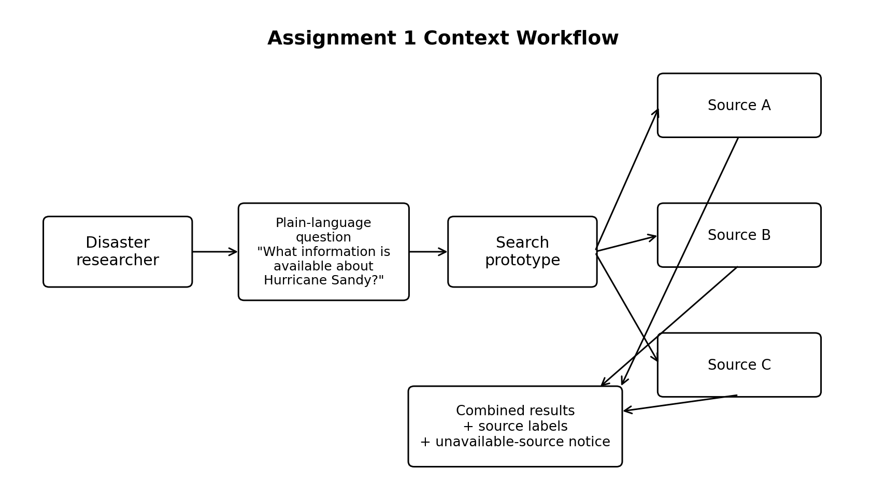

# Plain-Language Disaster Archive Search Design

**Author:** Raed Jaber  
**Course:** CSC 59866  
**Selected project and option:** A08 — Plain-Language Search Across Disaster Data Archives, based on NSF Project 10 (Award 2609535)  
**Current assignment:** 1 — Problem and Markdown foundation  
**Friday commit deadline:** November 6, 2026, at 11:59 p.m. New York time  
**Monday presentation:** November 9, 2026, at 6:30 p.m. New York time  
**Last updated:** November 5, 2026  
**Document status:** Proposed

## Progress note

This week I narrowed A08 into one specific product direction based on NSF Project 10, Award 2609535. Instead of trying to reproduce DISCAT 2.0, my six-week contribution will focus on one event-focused plain-language search operation. A disaster researcher will enter a question that names a disaster event, and the prototype will search two or three simplified sources, combine matching results, and label each result by source. I also identified one adverse case: one source is unavailable while the others still respond. The main unresolved issue is how much question interpretation is necessary for this small prototype. My next step is to define the initial input and output requirements and compare a simple keyword-based approach with another feasible search approach.

## Contents

- [1 Problem research and scope](#1-problem-research-and-scope)
- [2 Requirements and system specification](#2-requirements-and-system-specification)
- [3 Alternatives and selected solution](#3-alternatives-and-selected-solution)
- [4 Architectural design](#4-architectural-design)
- [5 Component design and interfaces](#5-component-design-and-interfaces)
- [6 Data structure design](#6-data-structure-design)
- [7 Algorithm design and execution](#7-algorithm-design-and-execution)
- [8 Failures and security](#8-failures-and-security)
- [9 Implementation and feasibility](#9-implementation-and-feasibility)
- [10 Testing and verification](#10-testing-and-verification)
- [11 Operation maintenance and future work](#11-operation-maintenance-and-future-work)
- [12 Revision history and references](#12-revision-history-and-references)

## 1 Problem research and scope

### Problem and affected people

The primary user for this project is a **disaster researcher** who needs to find information that may be stored across separate disaster-data archives. The larger NSF Project 10 also identifies emergency managers and policy stakeholders as intended users of DISCAT 2.0, but the first prototype will focus on the researcher's search task.

NSF Award 2609535 describes DISCAT 2.0 as a planned system that connects existing disaster archives and makes it easier for users to ask questions in plain language. My project takes one small capability from that larger idea: an event-focused question should return useful, source-labeled results from more than one disaster-data source.

Source: https://www.nsf.gov/awardsearch/show-award?AWD_ID=2609535

### Current workflow

**Assumption to verify:** A disaster researcher who needs information from several independent archives may currently have to identify relevant sources, open them separately, adapt the search to each source, inspect results in different formats, and combine the useful findings manually.

For this design, I am not claiming that every disaster researcher follows exactly this workflow. The NSF project establishes the broader need to connect existing disaster archives and make them easier to query. The exact current workflow for my intended user still needs additional evidence.

A simplified current workflow is:

1. The researcher identifies a disaster event and information need.
2. The researcher decides which archives may contain useful material.
3. The researcher searches each archive separately.
4. The researcher reviews results from the different sources.
5. The researcher manually connects the relevant information.

The difficulty occurs mainly in steps 2–5 because the sources are separate and may organize or describe their information differently.

### Concrete scenario

A disaster researcher wants to know what information is available about **Hurricane Sandy**.

A representative question is:

> What information is available about Hurricane Sandy?

In the current assumed workflow, the researcher may need to search several archives separately and then compare the results.

In the proposed small product, the researcher enters the question once. The prototype identifies the disaster event, searches two or three simplified sources, and displays the matching results together. Every result shows its source.

The selected adverse case for the six-week prototype is that **one source is unavailable while the other sources are still available**. In that case, the search should still return the results it received and clearly identify the source that could not be searched. This is proposed behavior, not an observed result yet.

### Stakeholders and needs

| Stakeholder | Main need in this project | Current concern or difficulty |
| :--- | :--- | :--- |
| Disaster researcher | Find related disaster information without repeating the same search across several sources | Relevant information may be separated across independent archives |
| Emergency manager or policy stakeholder | Understand where returned information came from | Results need clear source attribution; this is a secondary user for the first prototype |
| Data repository or archive owner | Keep its information identifiable as coming from that source | Combined results should not hide or change source attribution |

### Evidence and assumptions

**Documented evidence:** NSF Project 10 states that DISCAT 2.0 will connect existing disaster archives, make it easier to ask questions in plain language, and include a federated data layer. This establishes the larger problem area and directly motivates the capability I am narrowing for this project.

https://www.nsf.gov/awardsearch/show-award?AWD_ID=2609535

**Existing approach:** The World Wide Web Consortium's Data Catalog Vocabulary (DCAT) Version 3 describes a standard vocabulary for datasets and data services. It supports aggregation of metadata from multiple catalogs and federated search across catalogs at multiple sites. This helps me understand how separate sources can expose information in a common structure.

https://www.w3.org/TR/vocab-dcat-3/

**Assumption:** A simple event-focused question, such as a question naming Hurricane Sandy, is a useful small input for the first prototype. I have not yet validated this exact question format with an actual disaster researcher.

**Assumption:** Two or three simplified sources are enough to demonstrate the main discovery path during the six-week design period. This is a project-scope choice, not a claim about the number of sources needed by a real national system.

### Six-week contribution

The six-week contribution will be one small end-to-end capability:

> A disaster researcher enters an event-focused plain-language question that names a disaster event. The prototype searches two or three simplified disaster-data sources and returns one combined list of matching results with a source label for every result.

The initial question set will be deliberately small. The prototype will focus on questions that identify a named disaster event, such as Hurricane Sandy, instead of attempting to understand arbitrary natural-language questions.

The normal case is that all selected sources respond. The selected adverse case is that one source is unavailable. In that case, the proposed behavior is to return results from the available sources and show a clear unavailable-source notice.

### Semester II scope

The larger Semester II goal is to turn the six-week working path into a more complete disaster-data discovery product. Possible additions include:

- connecting to more realistic or public disaster-data sources,
- supporting a wider range of plain-language questions,
- improving result ranking and filtering,
- improving source and provenance information,
- and refining unavailable-source handling based on what is learned from the first implementation.

These are future goals. They are not claims about what Assignment 1 already implements.

### Exclusions

The six-week prototype will **not** attempt to build the full DISCAT 2.0 system.

The following are explicitly outside the current scope:

- a national-scale disaster-data platform,
- multiple autonomous AI agents,
- a complete disaster-science knowledge graph,
- arbitrary natural-language question answering,
- personalized results for every possible user role,
- production authentication and authorization,
- sensitive or private disaster data,
- disaster prediction,
- and production-scale reliability guarantees.

These exclusions keep the project focused on one understandable search operation that can be designed and demonstrated by one student.

### Workflow / context image

**Figure 1.** The six-week project focuses on one search path. A disaster researcher asks an event-focused question, the prototype searches a few independent sources, and the user receives combined results with source labels. One source may be unavailable while the others still return results.

## 2 Requirements and system specification

**Work to come in Assignment 2.** This section will define the initial functional requirements, correctness rule, measurable quality target, inputs, outputs, assumptions, constraints, and acceptance checks.

## 3 Alternatives and selected solution

**Work to come in Assignments 2–3.** This section will compare at least two approaches against the same requirements before selecting a design.

## 4 Architectural design

**Work to come in Assignment 3.** This section will show the system boundary, main running parts, communication, dependencies, and what is built, reused, or simulated.

## 5 Component design and interfaces

**Work to come in Assignment 3.** This section will define component responsibilities and the interface contract for the critical search operation.

## 6 Data structure design

**Work to come in Assignment 4.** This section will define the records, fields, relationships, ownership, persistence, and data rules.

## 7 Algorithm design and execution

**Work to come in Assignment 4.** This section will provide pseudocode and normal, interrupted, and overlapping execution behavior for the critical operation.

## 8 Failures and security

**Work to come in Assignment 4.** This section will describe relevant adverse scenarios, misuse cases, expected behavior, and planned checks.

## 9 Implementation and feasibility

**Work to come beginning in Assignment 3.** This section will define the smallest useful implementation path, a feasibility question, current implementation status, and later run instructions.

## 10 Testing and verification

**Work to come beginning in Assignment 4.** This section will connect planned tests to requirements and later distinguish expected results from actual observations.

## 11 Operation maintenance and future work

**Work to come beginning in Assignment 4.** This section will cover startup, diagnosis, recovery, risks, maintenance, and the Semester II continuation plan.

## 12 Revision history and references

### Revision history

| Revision date | Change to my design | Reason and evidence |
| :--- | :--- | :--- |
| November 5, 2026 | Created the Assignment 1 design foundation and narrowed the project to one event-focused plain-language search path | The course handbook requires one bounded six-week contribution rather than reproducing the full funded project |
| November 5, 2026 | Kept unavailable-source behavior as the selected adverse case instead of making it the entire project | The product goal is disaster-data discovery; unavailable-source handling is one important condition within that product |

### Open question

| Open question | Why it matters | Next action |
| :--- | :--- | :--- |
| Can the first prototype interpret event-focused questions with a simple keyword/event-name approach, or is a more advanced language-processing method necessary? | The answer affects the complexity of the six-week implementation and the meaning of “plain-language search” | In Assignment 2, define the supported question format and compare at least two feasible approaches |

### Assistance and reuse

The design is based on the course design template and handbook, NSF Project 10, and the W3C DCAT specification. AI assistance was used to help organize and draft this initial Markdown document and workflow figure. The author is responsible for reviewing, revising, understanding, and presenting all submitted content according to course policy.

### References

1. **National Science Foundation.** *Category III: AI-Driven National Synthesis Hub for Convergent Disaster Research and Intelligence.* NSF Award 2609535.  
   https://www.nsf.gov/awardsearch/show-award?AWD_ID=2609535

2. **World Wide Web Consortium (W3C).** *Data Catalog Vocabulary (DCAT) Version 3.* W3C Recommendation, August 22, 2024.  
   https://www.w3.org/TR/vocab-dcat-3/

### Supporting media and evidence

- [Workflow/context image](assets/workflow.png) — Figure 1 for Assignment 1.
- No implementation or measured test evidence is claimed in Assignment 1. Later evidence will be placed in `evidence/` as required.

### Final document check

Assignment 1 status:

- [x] The affected user and difficulty are stated.
- [x] A concrete scenario is included.
- [x] Evidence and assumptions are distinguished.
- [x] The six-week contribution is bounded.
- [x] The larger Semester II goal is stated.
- [x] Explicit exclusions are stated.
- [x] A stakeholder table is included.
- [x] A workflow image has alternative text and a caption.
- [x] Working source links are included.
- [x] A 100–150 word progress note is included.
- [x] One open question is included.
- [x] Later sections are marked as work to come.
